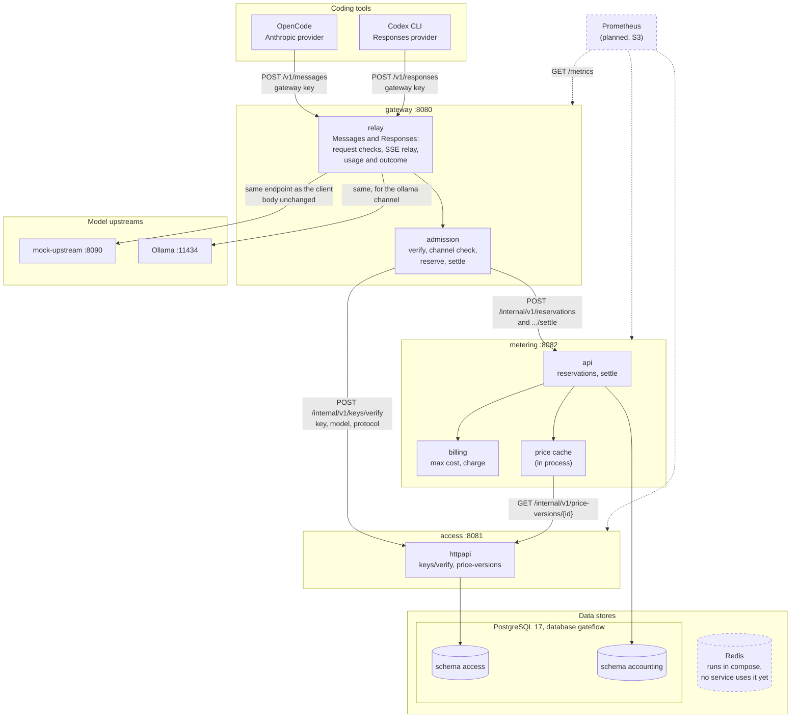
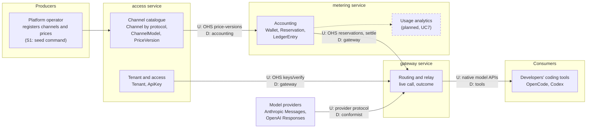
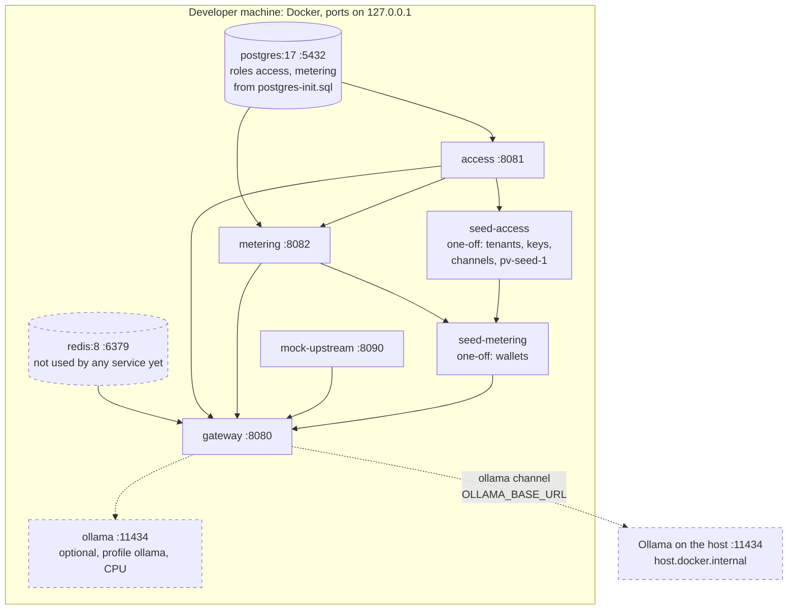
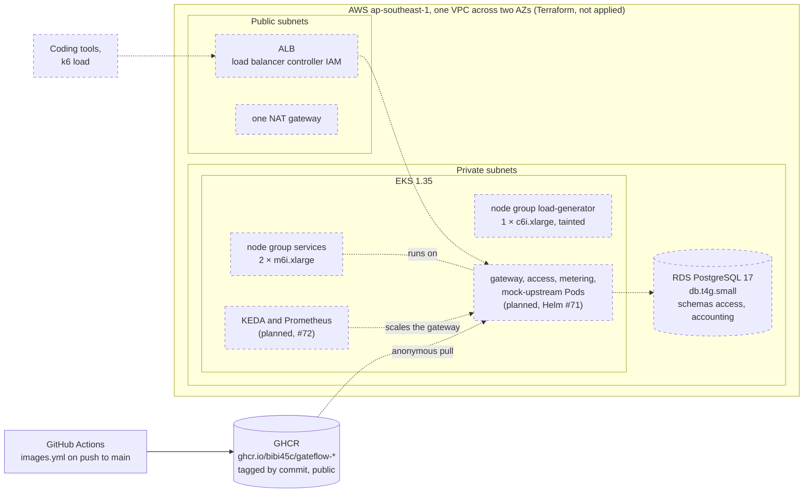
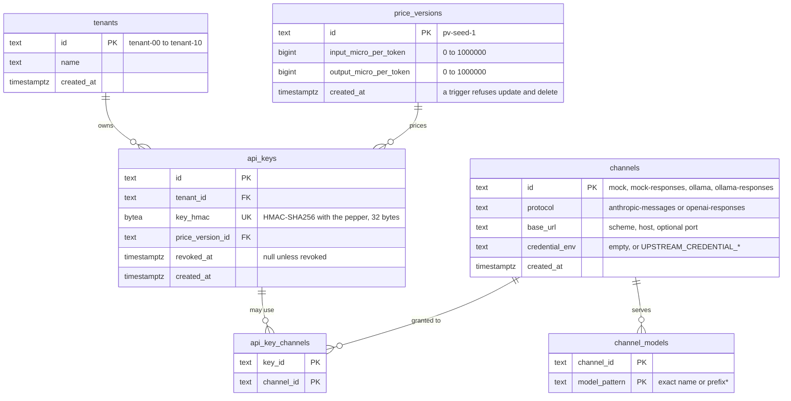
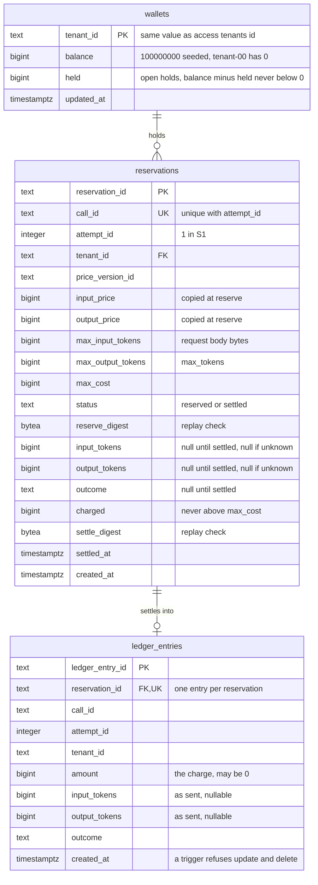
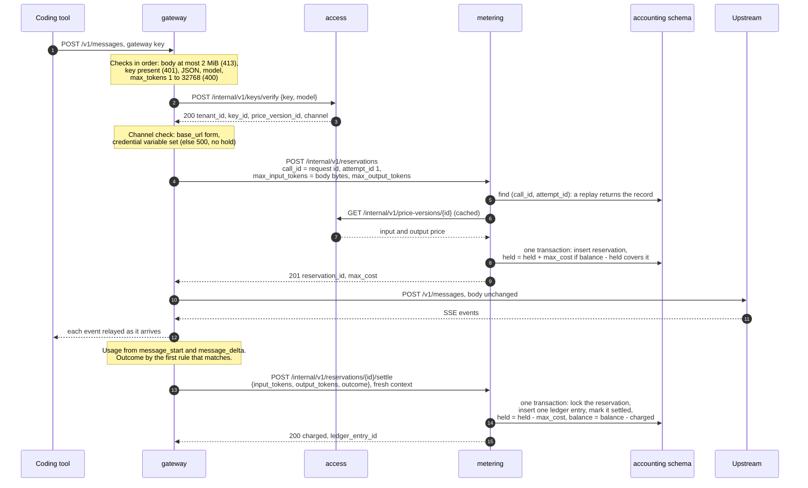
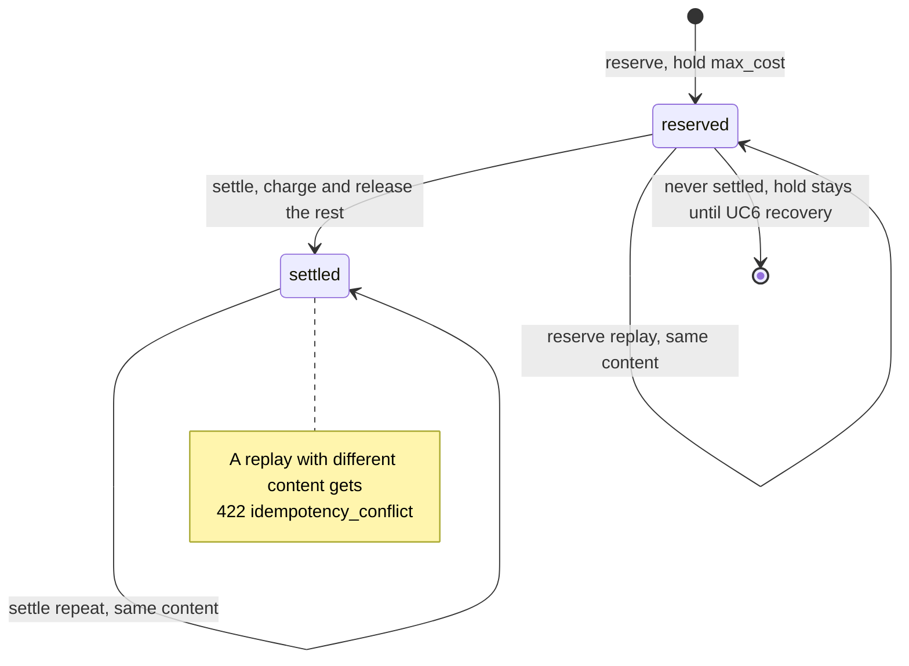

# As-built architecture views

These views show FlowGate as it is built on `main`, not as the proposal planned it.
They are drawn from the code, and every diagram names the files it was checked
against, so a reviewer can compare the two. Where the build differs from the
proposal, the difference is listed under [Deviations](#7-deviations-from-the-proposal).

- **Snapshot:** `main` at `de208ff` (15 October 2026). The first version was drawn at
  `31d5c4a` (14 October). The views are checked again at the freeze on 19 October,
  before they go into the slides (#17).
- **Scope:** S1 and S2 as built: `POST /v1/messages` and `POST /v1/responses` through
  the gateway, key verification by model and protocol, cost hold and settlement, and
  Prometheus metrics on every service. The S3 cloud environment is written as
  Terraform and the images are published, but nothing is deployed yet; the cloud
  view marks what is *planned*.
- **Legend:** solid lines and boxes are built and on `main`; dashed ones are planned
  or present but unused.
- The earlier diagrams in [index.html](index.html) were drawn from the plans before
  the code existed. Where the two disagree, this page follows the code.

Contents:

1. [Logical view](#1-logical-view)
2. [Context map](#2-context-map)
3. [Physical view: local stack](#3-physical-view-local-stack)
4. [Physical view: cloud](#4-physical-view-cloud)
5. [Persistence view](#5-persistence-view)
6. [Use case design: reserve and settle one call](#6-use-case-design-reserve-and-settle-one-call)
7. [Deviations from the proposal](#7-deviations-from-the-proposal)

## 1. Logical view

Three business services, each with its own process, configuration and data. Coding
tools call only the gateway. The gateway calls access and metering through their
internal HTTP APIs, and metering calls access for prices. No service reads another
service's tables.

| Call | Authentication | Timeout and retries |
|---|---|---|
| tool → gateway, `/v1/messages` or `/v1/responses` | gateway key in `x-api-key` or `Authorization: Bearer` | none on the reply; upstream connect 10 s |
| gateway → access, verify | `Bearer ACCESS_INTERNAL_TOKEN`; the body names the protocol for Responses, and a missing protocol means Messages | 2 s, no retry |
| gateway → metering, reserve | `Bearer METERING_INTERNAL_TOKEN` | 2 s, retried once on a timeout, 5xx or connection error |
| gateway → metering, settle | `Bearer METERING_INTERNAL_TOKEN` | 2 s per attempt, up to 2 retries, with a fresh context |
| metering → access, price version | `Bearer ACCESS_INTERNAL_TOKEN` | 1 s; each version is cached for the life of the process |
| gateway → upstream, Messages | none for the mock and Ollama; otherwise the channel's `credential_env` value as `x-api-key` | connect 10 s; forwards only `content-type`, `anthropic-version` and `anthropic-beta` |
| gateway → upstream, Responses | the same credential as `Authorization: Bearer` | connect 10 s; forwards only `content-type` |
| scraper → every service, `GET /metrics` | none; for scrapes inside the cluster only, never routed by the ingress | — |

Every internal call carries `X-Request-Id`, the gateway's `req_<uuid>`, and every
internal error uses the body in [api/errors.md](../../api/errors.md).

Checked against: `services/gateway/main.go`,
`services/gateway/internal/admission/admission.go`, `.../admission/settle.go`,
`.../internalapi/caller.go`, `.../relay/relay.go`, `.../relay/protocol.go`,
`.../relay/messages.go`, `.../relay/responses.go`, `.../relay/upstream.go`,
`.../accessclient/client.go`, `services/access/main.go`,
`services/metering/main.go`, `services/metering/internal/accessclient/accessclient.go`,
`services/access/internal/httpapi/httpapi.go`.

## 2. Context map

Five logical contexts map to three deployed services, as proposal section 5.3 planned.
Each arrow points from the upstream context (U), which publishes a contract, to the
downstream context (D), which uses it. The internal contracts are an *Open Host
Service* with a *Published Language*: [api/access.yaml](../../api/access.yaml),
[api/metering.yaml](../../api/metering.yaml) and [api/errors.md](../../api/errors.md).

| Context | Service | Owns | Relationship |
|---|---|---|---|
| Tenant and access | access | `tenants`, `api_keys`, `api_key_channels` | Upstream of the gateway through `keys/verify` |
| Channel catalogue | access | `channels`, `channel_models`, `price_versions` (immutable) | Upstream of accounting through `price-versions` |
| Routing and relay | gateway | no tables; the live call only | Downstream of access and accounting. Conformist to the provider protocols: the body goes upstream unchanged, and the wire types in `pkg/protocol/` are a shared kernel of technical types only, with no business rules |
| Accounting | metering | `wallets`, `reservations`, `ledger_entries` | Upstream of the gateway through reserve and settle |
| Usage analytics | metering (planned) | reads the ledger | Planned with UC7; no API yet |

The `test/archtest` package fails the build when one service imports another
service's packages, so the boundaries above hold in the code as well as at runtime.

Checked against: `services/*/internal/`, `pkg/protocol/`, `test/archtest/`,
`api/*.yaml`, `services/access/internal/seed/seed.go`.

## 3. Physical view: local stack

The local stack is `deploy/compose/compose.yaml`. Every port binds to `127.0.0.1`
only. An arrow means "starts after": the lower box waits until the upper one is
healthy, or, for the seed steps, has finished.

- Each service image is built from one `deploy/docker/Dockerfile` and runs as a
  distroless, non-root binary. The binary checks its own `/healthz` for the health
  checks, because the image has no shell or curl.
- Containers stop with a 15 s grace period, longer than the services' 10 s drain.
- The seed steps run on every `up` and change nothing when the data exists. Keys are
  printed only in the `seed-access` log.

Checked against: `deploy/compose/compose.yaml`, `deploy/compose/postgres-init.sql`,
`deploy/docker/Dockerfile`, `pkg/server/server.go`.

## 4. Physical view: cloud

*Written, not deployed.* The S3 environment exists as Terraform on `main` (#90), and
CI publishes a versioned image of every service (#83), but nothing has been applied
to AWS yet. Only bibi45c runs `terraform apply`, after the spend is approved. The
Helm chart (#71), KEDA with Prometheus (#72) and the deployment script (#76) are
still to come, so the Pods, the ingress and the scaling are dashed.

- **Built:** the image pipeline. Every push to `main` publishes four images tagged with
  the commit, with OCI source and revision labels, and records their digests in the
  job summary; pull requests build without pushing. The images pull without a login
  (being checked on team machines in #21).
- **Written and tested without AWS:** the Terraform modules `network`, `cluster` and
  `database`, checked in CI with `terraform validate` and `terraform test` against
  mocked providers. Redis is left out, so no ElastiCache is created.
- **Planned:** applying it, the workloads, autoscaling and the scripted deployment with
  rollback.

Checked against: `deploy/terraform/` (`main.tf`, `variables.tf`, `modules/*`, `README.md`),
`.github/workflows/images.yml`, `deploy/docker/README.md`, #21.

## 5. Persistence view

One PostgreSQL database, `gateflow`, holds two schemas. Each schema is owned by its
service's own login role, and every schema, `public` included, is closed to every
other role, so the access role cannot read accounting tables and the reverse. Each
service applies its own migrations at startup through `pkg/pgmigrate`. There are no
cross-schema foreign keys or joins: `tenant_id` matches between the schemas by value
only.

### Schema access (role access)

- The raw key is never stored; a lookup hashes the presented key and uses the unique
  index on `key_hmac`.
- A credential is only allowed over `https`: a check constraint refuses a
  `credential_env` on an `http` channel.
- Migration `0002` widened the protocol check to `anthropic-messages` and
  `openai-responses`, without changing a row. The seed gives each upstream a Messages
  channel and a Responses twin (`mock-responses`, `ollama-responses`) that serve the
  same models, and verify picks among the key's channels that speak the requested
  protocol.

### Schema accounting (role metering)

- Check constraints keep a `reserved` row free of settlement values, and require a
  `settled` row to have an outcome, a charge and a time.
- `ledger_entries` is append-only: a correction is a new entry.

Checked against: `services/access/migrations/0001_init.sql`, `.../0002_channel_protocols.sql`,
`services/access/internal/seed/seed.go`, `services/access/internal/store/queries.go`,
`services/metering/migrations/0001_init.sql`, `deploy/compose/postgres-init.sql`,
`pkg/pgmigrate/pgmigrate.go`, `services/metering/main.go`.

## 6. Use case design: reserve and settle one call

The representative use case is **UC6, reserve and settle simulated usage**, as it
runs inside **UC4**, one `POST /v1/messages` call. The `/v1/responses` call follows
the same steps; its differences are listed below the sequence. It crosses all three services and
both schemas, and it carries most of the S1 rules: the order of checks, the
idempotent internal calls and the charge rule.

### Sequence

Refusals end the call before the upstream is reached, and leave no ledger entry:

| Where | Internal answer | What the tool gets |
|---|---|---|
| verify | 401 `invalid_key` | 401 `authentication_error` |
| verify | 403 `model_not_allowed` | 403 `permission_error` |
| reserve | 409 `insufficient_balance`, 404 `wallet_not_found` | 402 `billing_error` |
| verify or reserve | timeout, unreachable, `dependency_unavailable` | 503 `api_error` |
| anything else | any other code | 500 `api_error`, logged |

### The same flow on `/v1/responses`

`POST /v1/responses` (S2, #65) runs the same admission, reserve, relay and settle
steps; only the wire format differs:

| Step | `/v1/messages` | `/v1/responses` |
|---|---|---|
| Verify | protocol left out, so `anthropic-messages` | protocol `openai-responses`, so a `*-responses` channel |
| Output bound held | `max_tokens`, required, 1 to 32,768 | `max_output_tokens`, 1 to 32,768; when absent, the gateway sets it to 32,768 in the body it forwards and holds that |
| Refused before admission | — | `previous_response_id`, with 400: the gateway keeps no response state |
| Usage source | `message_start` and `message_delta`, cache tokens added to input | `response.completed` usage; cached input tokens are part of `input_tokens` |
| Public errors | Anthropic error body | OpenAI error body |

### Reservation states

### Charge rule

`max_cost = max_input_tokens × input price + max_output_tokens × output price`. At
settlement, an unknown count is replaced by its maximum, and
`charged = min(max_cost, input × input price + output × output price)`.
`upstream_error` and `not_dispatched` charge 0. With `pv-seed-1` (3 and 15
micro-units per token), a call with 6,328 input and 449 output tokens is charged
6,328 × 3 + 449 × 15 = 25,719.

| Outcome | When (first rule that matches) | Charge |
|---|---|---|
| `not_dispatched` | no upstream request was sent | 0 |
| `completed` | `message_stop` arrived, or a full 2xx body was read | counts as reported |
| `client_cancelled` | the client disconnected first | unknown counts at their maximum |
| `upstream_error` | the upstream answered non-2xx before any output | 0 |
| `interrupted` | anything else, such as a dropped stream | unknown counts at their maximum |

Checked against: `services/gateway/internal/relay/relay.go`, `.../relay/request.go`,
`.../relay/result.go`, `services/gateway/internal/admission/`,
`services/metering/internal/api/`, `services/metering/internal/billing/billing.go`,
`services/metering/internal/store/reservations.go`, `services/gateway/internal/relay/responses.go`,
[api/metering.yaml](../../api/metering.yaml).

## 7. Deviations from the proposal

Recorded in #18, the gate record (#20) and the [feasibility plan](../feasibility-plan.md).

| Proposal | As built | Why |
|---|---|---|
| Transactional outbox, SQS and idempotent consumers for usage views (sections 5.1, 5.4) | Reservation and settlement in PostgreSQL transactions only; no outbox, no queue | Keeps S1 small; planned with UC6 after the gate |
| A pending reservation waits for recovery when usage is unknown | An unknown count is charged at its maximum; a hold whose settle fails stays held until UC6 | No recovery process in S1 |
| Redis for limits and the key cache | Redis runs in compose, but no service uses it; no key cache | Not needed until rate limits or caching land |
| Keys and channels created through APIs (UC1, UC2) | Seed commands write each service's own schema | The key and channel APIs come later |
| Separate prices for cache and reasoning tokens | Cache tokens are charged at the full input price, on Messages and on Responses (where cached tokens are inside `input_tokens`); thinking tokens arrive in `output_tokens` | One price pair per version in S1 |
| Conversation state through the gateway | `/v1/responses` is stateless: `previous_response_id` is refused, and clients resend the conversation | The gateway keeps no response state |
| Per-caller internal identities | One shared token for access; metering trusts the gateway's `tenant_id` and `price_version_id` | mTLS and workload identity are out of S1 |
| Claude Code and Codex CLI as the acceptance clients (UC3) | OpenCode on Messages; Codex CLI on Responses (guide #103) | Claude Code needs a Claude service |
| Aurora, Argo CD, Cognito and CloudFront (section 5.5) | Plain RDS PostgreSQL in Terraform, images in GHCR instead of ECR, a scripted deployment (planned, #76) | Cost and time |
| Distributed tracing (UC15) | Prometheus metrics and JSON logs only (`docs/observability.md`) | Tracing is optional and its overhead unmeasured |
