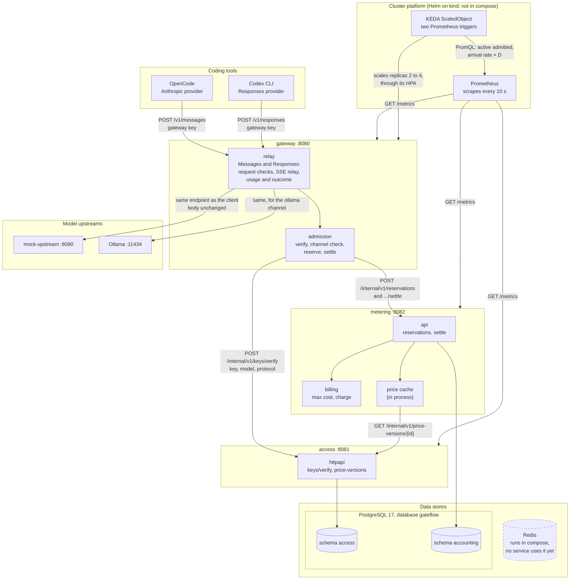
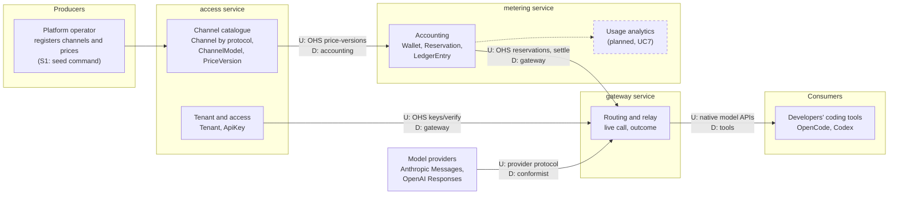
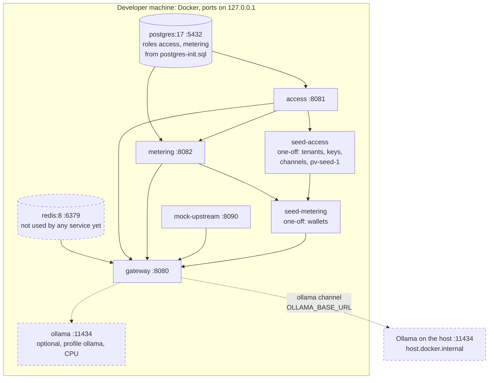
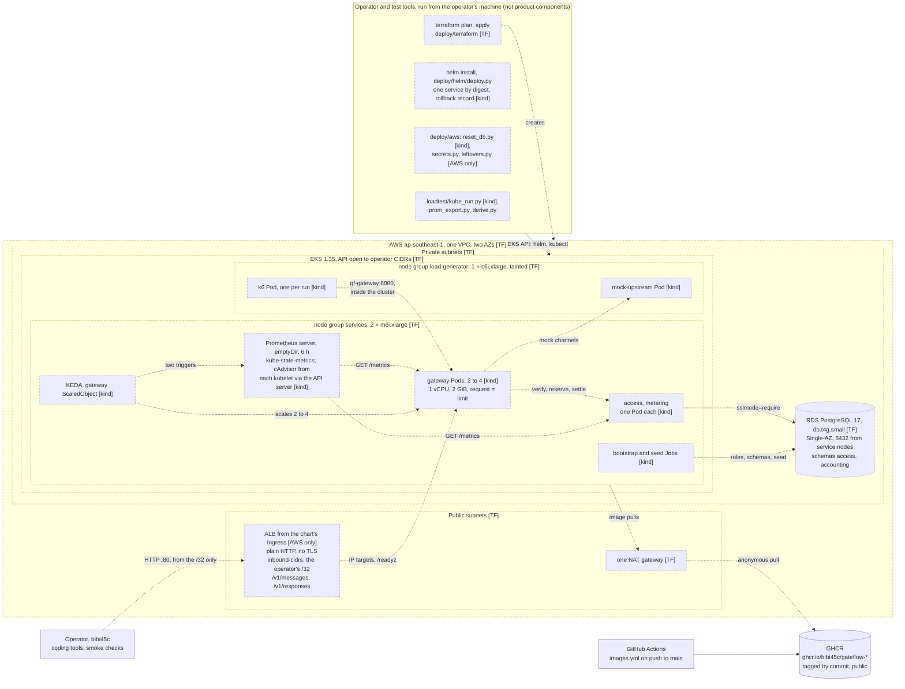
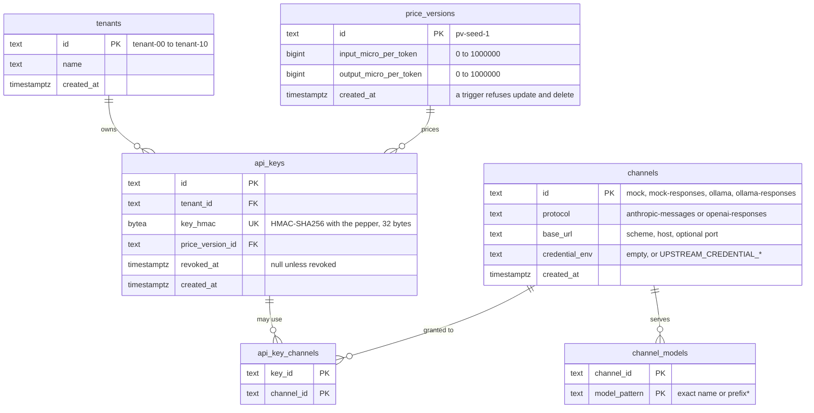
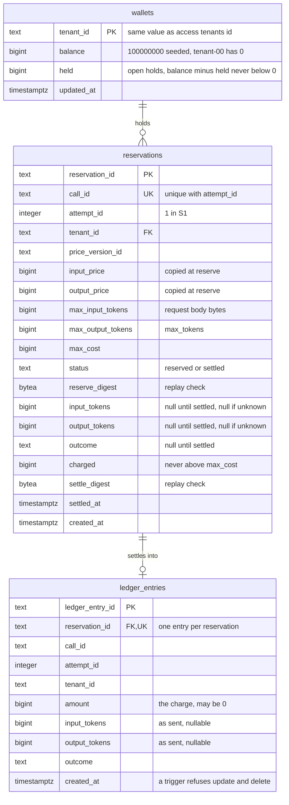
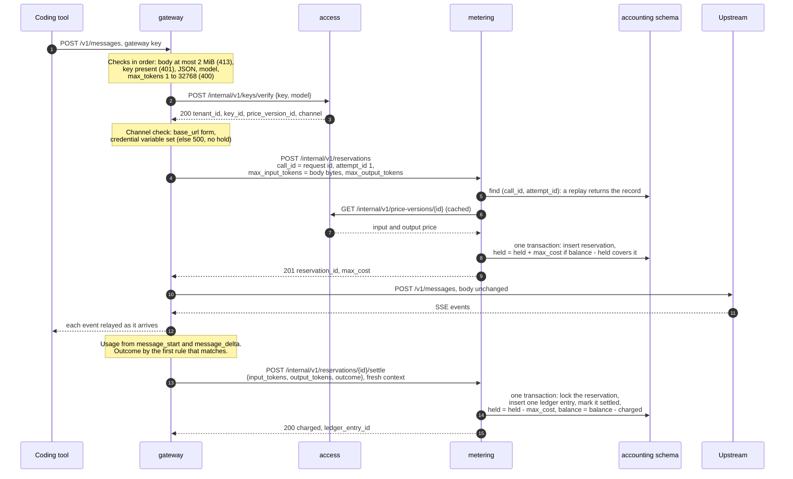
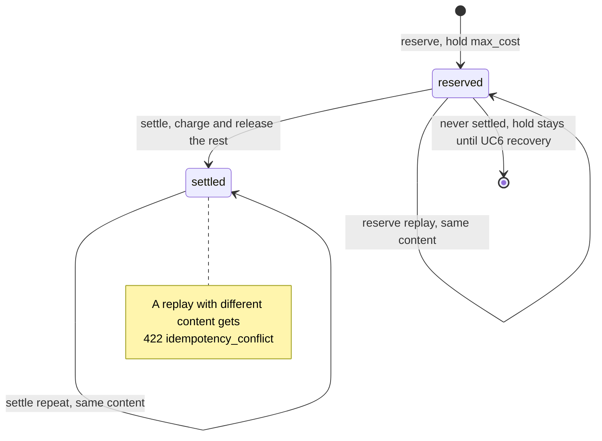

# As-built architecture views

These views show FlowGate as it is built on `main`, not as the proposal planned it.
They are drawn from the code, and every diagram names the files it was checked
against, so a reviewer can compare the two. Where the build differs from the
proposal, the difference is listed under [Deviations](#7-deviations-from-the-proposal).

- **Snapshot:** `main` at `467167c` (16 October 2026). Earlier versions were drawn at
  `31d5c4a` (14 October) and `de208ff` (15 October). The S3 cloud runs have not
  happened yet; the first is on 17 October. The views are checked again at the
  freeze on 19 October, before they go into the slides (#17).
- **Scope:** S1 and S2 as built: `POST /v1/messages` and `POST /v1/responses` through
  the gateway, key verification by model and protocol, cost hold and settlement, and
  Prometheus metrics on every service. S3 as built: the Helm chart, KEDA autoscaling,
  Prometheus, in-cluster k6 and `deploy.py`, all run on kind. The `deploy/aws`
  scripts have not run against EKS or RDS; of them, `reset_db.py` has run on kind.
  The AWS environment is written as Terraform but not applied.
- **Legend:**
  - Solid box: built on `main` and run, locally, in CI or on kind.
  - Dotted box (`stroke-dasharray:2 2`): on `main` but not yet run where it is drawn.
    Only the cloud view uses it, with a tag in the label:
    **[TF]** Terraform written, not applied;
    **[kind]** run on kind, not yet on EKS;
    **[AWS only]** tested without AWS, but only the AWS path uses it, so it has
    not yet run against EKS or RDS.
  - Dashed box (`stroke-dasharray:5 5`): planned, optional, or present but unused.
  - Solid arrow: the call runs today. Dotted arrow (`-.->`): it does not run yet,
    because it is planned, optional or, in the cloud view, not deployed.
- The earlier diagrams in [index.html](index.html) were drawn from the plans before
  the code existed. Where the two disagree, this page follows the code.

Contents:

1. [Logical view](#1-logical-view)
2. [Context map](#2-context-map)
3. [Physical view: local stack](#3-physical-view-local-stack)
4. [Physical view: cloud](#4-physical-view-cloud)
5. [Persistence view](#5-persistence-view)
6. [Use case design: reserve and settle one call](#6-use-case-design-reserve-and-settle-one-call)
7. [Deviations from the proposal](#7-deviations-from-the-proposal)

## 1. Logical view

Three business services, each with its own process, configuration and data. Coding
tools call only the gateway. The gateway calls access and metering through their
internal HTTP APIs, and metering calls access for prices. No service reads another
service's tables.

In the cluster, Prometheus scrapes the three services, and a KEDA ScaledObject scales
the gateway on two Prometheus signals. The chart turns autoscaling on with
`values-aws.yaml` and in the kind autoscale check; otherwise the gateway runs a
fixed replica count. Operator scripts and k6 are not shown here: they are tools for
operating and testing, not product components (see the cloud view).

| Call | Authentication | Timeout and retries |
|---|---|---|
| tool → gateway, `/v1/messages` or `/v1/responses` | gateway key in `x-api-key` or `Authorization: Bearer` | none on the reply; upstream connect 10 s |
| gateway → access, verify | `Bearer ACCESS_INTERNAL_TOKEN`; the body names the protocol for Responses, and a missing protocol means Messages | 2 s, no retry |
| gateway → metering, reserve | `Bearer METERING_INTERNAL_TOKEN` | 2 s, retried once on a timeout, 5xx or connection error |
| gateway → metering, settle | `Bearer METERING_INTERNAL_TOKEN` | 2 s per attempt, up to 2 retries, with a fresh context |
| metering → access, price version | `Bearer ACCESS_INTERNAL_TOKEN` | 1 s; each version is cached for the life of the process |
| gateway → upstream, Messages | none for the mock and Ollama; otherwise the channel's `credential_env` value as `x-api-key` | connect 10 s; forwards only `content-type`, `anthropic-version` and `anthropic-beta` |
| gateway → upstream, Responses | the same credential as `Authorization: Bearer` | connect 10 s; forwards only `content-type` |
| Prometheus → gateway, access, metering, `GET /metrics` | none; for scrapes inside the cluster only, never routed by the ingress | scrape every 10 s, timeout 5 s |
| KEDA → Prometheus, two queries | none; inside the cluster | a query is empty unless every gateway target is up and fresh; KEDA then reports an error, never a zero, and the HPA does not scale down on it |

Every internal call carries `X-Request-Id`, the gateway's `req_<uuid>`, and every
internal error uses the body in [api/errors.md](../../api/errors.md).

Checked against: `services/gateway/main.go`,
`services/gateway/internal/admission/admission.go`, `.../admission/settle.go`,
`.../internalapi/caller.go`, `.../relay/relay.go`, `.../relay/protocol.go`,
`.../relay/messages.go`, `.../relay/responses.go`, `.../relay/upstream.go`,
`.../accessclient/client.go`, `services/access/main.go`,
`services/metering/main.go`, `services/metering/internal/accessclient/accessclient.go`,
`services/access/internal/httpapi/httpapi.go`,
`deploy/helm/gateflow/templates/scaledobject.yaml`, `deploy/helm/gateflow/values.yaml`,
`deploy/helm/values-aws.yaml`, `deploy/helm/monitoring/prometheus-values.yaml`,
`deploy/helm/README.md` (Autoscaling).

## 2. Context map

Five logical contexts map to three deployed services, as proposal section 5.3 planned.
Each arrow points from the upstream context (U), which publishes a contract, to the
downstream context (D), which uses it. The internal contracts are an *Open Host
Service* with a *Published Language*: [api/access.yaml](../../api/access.yaml),
[api/metering.yaml](../../api/metering.yaml) and [api/errors.md](../../api/errors.md).

| Context | Service | Owns | Relationship |
|---|---|---|---|
| Tenant and access | access | `tenants`, `api_keys`, `api_key_channels` | Upstream of the gateway through `keys/verify` |
| Channel catalogue | access | `channels`, `channel_models`, `price_versions` (immutable) | Upstream of accounting through `price-versions` |
| Routing and relay | gateway | no tables; the live call only | Downstream of access and accounting. Conformist to the provider protocols: the body goes upstream unchanged, and the wire types in `pkg/protocol/` are a shared kernel of technical types only, with no business rules |
| Accounting | metering | `wallets`, `reservations`, `ledger_entries` | Upstream of the gateway through reserve and settle |
| Usage analytics | metering (planned) | reads the ledger | Planned with UC7; no API yet |

The `test/archtest` package fails the build when one service imports another
service's packages, so the boundaries above hold in the code as well as at runtime.

Checked against: `services/*/internal/`, `pkg/protocol/`, `test/archtest/`,
`api/*.yaml`, `services/access/internal/seed/seed.go`.

## 3. Physical view: local stack

The local stack is `deploy/compose/compose.yaml`. Every port binds to `127.0.0.1`
only. An arrow means "starts after": the lower box waits until the upper one is
healthy, or, for the seed steps, has finished.

- Each service image is built from one `deploy/docker/Dockerfile` and runs as a
  distroless, non-root binary. The binary checks its own `/healthz` for the health
  checks, because the image has no shell or curl.
- Containers stop with a 15 s grace period, longer than the services' 10 s drain.
- The seed steps run on every `up` and change nothing when the data exists. Keys are
  printed only in the `seed-access` log.

Checked against: `deploy/compose/compose.yaml`, `deploy/compose/postgres-init.sql`,
`deploy/docker/Dockerfile`, `pkg/server/server.go`.

## 4. Physical view: cloud

*Written, not deployed.* Everything in AWS is on `main` but has not run yet. The
Terraform (#90) is not applied; the first apply is on 17 October, and only bibi45c
runs it. The Helm chart (#106), KEDA with Prometheus (#112, #118), the in-cluster k6
(#117, #119) and the deployment script (#111) run on kind, not yet on EKS. Only the
image pipeline (#83) and GHCR run today. So every AWS box is dotted, with a tag for
its state (see the legend).

- **Runs today:** the image pipeline. Every push to `main` publishes four images
  tagged with the commit, with OCI source and revision labels, and records their
  digests in the job summary; pull requests build without pushing. The images pull
  without a login (being checked on team machines in #21).
- **[TF], written and tested without AWS:** the Terraform modules `network`,
  `cluster` and `database`, checked in CI with `terraform validate` and
  `terraform test` against mocked providers. Redis is left out, so no ElastiCache is
  created. The load-generator node group carries the
  `gateflow.io/workload=load-generator:NoSchedule` taint.
- **[kind], run on kind, not yet on EKS:** CI installs the chart on kind, upgrades it
  and rehearses a one-service deploy and rollback with `deploy.py`
  (`.github/workflows/helm.yml`). The KEDA scale-up and scale-down check and the k6
  load check are kind rehearsals run by hand, not in CI
  (`rehearse.py --autoscale-check`, `--load-check`).
- **Pod placement:** gateway, access, metering, the bootstrap and seed Jobs,
  Prometheus, kube-state-metrics and KEDA select `gateflow.io/workload=services`.
  mock-upstream and k6 select `gateflow.io/workload=load-generator` and tolerate its
  taint, so they share the one generator node.
- **Scaling:** with `values-aws.yaml`, KEDA's HPA owns the gateway's replica count,
  between 2 and 4. T is 70 and D is 20 s, provisional until the 17 October single-Pod
  calibration (#73). access and metering stay at one replica.
- **[AWS only]:** the ALB annotations and the database TLS init check are rendered
  in the chart tests, but only `environment=aws` uses them. The ALB comes from the
  AWS Load Balancer Controller, which the operator installs separately; Terraform
  creates only its IAM role. The chart refuses to render for AWS without
  `ingress.inboundCidrs`, and refuses any `/0` unless `ingress.allowAnySource=true`.
  In `deploy/aws`, `secrets.py` and `leftovers.py` are also [AWS only]:
  `secrets.py` and `leftovers.py inventory` have only unit tests and have never run,
  and `leftovers.py check` has run once, read-only, against an empty AWS account.
  `reset_db.py` is [kind]: it has run on kind, not yet against RDS.
- **Operator only:** bibi45c runs every operator tool from an allowed IP. GitHub
  holds no AWS credentials, and no workflow deploys to AWS. On EKS the smoke suite
  reads the ledger through a short-lived query Pod on a services node
  (`--smoke-db-secret`), because there is no database Pod.

Checked against: `deploy/terraform/` (`main.tf`, `variables.tf`, `modules/*`, `README.md`),
`deploy/helm/gateflow/` (`values.yaml`, `templates/deployments.yaml`,
`templates/ingress.yaml`, `templates/scaledobject.yaml`), `deploy/helm/values-aws.yaml`,
`deploy/helm/monitoring/`, `deploy/helm/README.md`, `deploy/helm/deploy.py`,
`deploy/aws/`, `loadtest/kube_run.py`, `loadtest/README.md`,
`.github/workflows/images.yml`, `.github/workflows/helm.yml`,
`deploy/docker/README.md`, #21.

## 5. Persistence view

One PostgreSQL database, `gateflow`, holds two schemas. Each schema is owned by its
service's own login role, and every schema, `public` included, is closed to every
other role, so the access role cannot read accounting tables and the reverse. Each
service applies its own migrations at startup through `pkg/pgmigrate`. There are no
cross-schema foreign keys or joins: `tenant_id` matches between the schemas by value
only.

### Schema access (role access)

- The raw key is never stored; a lookup hashes the presented key and uses the unique
  index on `key_hmac`.
- A credential is only allowed over `https`: a check constraint refuses a
  `credential_env` on an `http` channel.
- Migration `0002` widened the protocol check to `anthropic-messages` and
  `openai-responses`, without changing a row. The seed gives each upstream a Messages
  channel and a Responses twin (`mock-responses`, `ollama-responses`) that serve the
  same models, and verify picks among the key's channels that speak the requested
  protocol.

### Schema accounting (role metering)

- Check constraints keep a `reserved` row free of settlement values, and require a
  `settled` row to have an outcome, a charge and a time.
- `ledger_entries` is append-only: a correction is a new entry.

Checked against: `services/access/migrations/0001_init.sql`, `.../0002_channel_protocols.sql`,
`services/access/internal/seed/seed.go`, `services/access/internal/store/queries.go`,
`services/metering/migrations/0001_init.sql`, `deploy/compose/postgres-init.sql`,
`pkg/pgmigrate/pgmigrate.go`, `services/metering/main.go`.

## 6. Use case design: reserve and settle one call

The representative use case is **UC6, reserve and settle simulated usage**, as it
runs inside **UC4**, one `POST /v1/messages` call. The `/v1/responses` call follows
the same steps; its differences are listed below the sequence. It crosses all three services and
both schemas, and it carries most of the S1 rules: the order of checks, the
idempotent internal calls and the charge rule.

### Sequence

Refusals end the call before the upstream is reached, and leave no ledger entry:

| Where | Internal answer | What the tool gets |
|---|---|---|
| verify | 401 `invalid_key` | 401 `authentication_error` |
| verify | 403 `model_not_allowed` | 403 `permission_error` |
| reserve | 409 `insufficient_balance`, 404 `wallet_not_found` | 402 `billing_error` |
| verify or reserve | timeout, unreachable, `dependency_unavailable` | 503 `api_error` |
| anything else | any other code | 500 `api_error`, logged |

### The same flow on `/v1/responses`

`POST /v1/responses` (S2, #65) runs the same admission, reserve, relay and settle
steps; only the wire format differs:

| Step | `/v1/messages` | `/v1/responses` |
|---|---|---|
| Verify | protocol left out, so `anthropic-messages` | protocol `openai-responses`, so a `*-responses` channel |
| Output bound held | `max_tokens`, required, 1 to 32,768 | `max_output_tokens`, 1 to 32,768; when absent, the gateway sets it to 32,768 in the body it forwards and holds that |
| Refused before admission | — | `previous_response_id`, with 400: the gateway keeps no response state |
| Usage source | `message_start` and `message_delta`, cache tokens added to input | `response.completed` usage; cached input tokens are part of `input_tokens` |
| Public errors | Anthropic error body | OpenAI error body |

### Reservation states

### Charge rule

`max_cost = max_input_tokens × input price + max_output_tokens × output price`. At
settlement, an unknown count is replaced by its maximum, and
`charged = min(max_cost, input × input price + output × output price)`.
`upstream_error` and `not_dispatched` charge 0. With `pv-seed-1` (3 and 15
micro-units per token), a call with 6,328 input and 449 output tokens is charged
6,328 × 3 + 449 × 15 = 25,719.

| Outcome | When (first rule that matches) | Charge |
|---|---|---|
| `not_dispatched` | no upstream request was sent | 0 |
| `completed` | `message_stop` arrived, or a full 2xx body was read | counts as reported |
| `client_cancelled` | the client disconnected first | unknown counts at their maximum |
| `upstream_error` | the upstream answered non-2xx before any output | 0 |
| `interrupted` | anything else, such as a dropped stream | unknown counts at their maximum |

Checked against: `services/gateway/internal/relay/relay.go`, `.../relay/request.go`,
`.../relay/result.go`, `services/gateway/internal/admission/`,
`services/metering/internal/api/`, `services/metering/internal/billing/billing.go`,
`services/metering/internal/store/reservations.go`, `services/gateway/internal/relay/responses.go`,
[api/metering.yaml](../../api/metering.yaml).

## 7. Deviations from the proposal

Recorded in #18, the gate record (#20) and the [feasibility plan](../feasibility-plan.md).
The S3 rows come from [deploy/helm/README.md](../../deploy/helm/README.md),
[loadtest/README.md](../../loadtest/README.md) and
[docs/observability.md](../observability.md).

| Proposal | As built | Why |
|---|---|---|
| Transactional outbox, SQS and idempotent consumers for usage views (sections 5.1, 5.4) | Reservation and settlement in PostgreSQL transactions only; no outbox, no queue | Keeps S1 small; planned with UC6 after the gate |
| A pending reservation waits for recovery when usage is unknown | An unknown count is charged at its maximum; a hold whose settle fails stays held until UC6 | No recovery process in S1 |
| Redis for limits and the key cache | Redis runs in compose, but no service uses it; the chart and Terraform leave it out; no key cache | Not needed until rate limits or caching land |
| Keys and channels created through APIs (UC1, UC2) | Seed commands write each service's own schema | The key and channel APIs come later |
| Separate prices for cache and reasoning tokens | Cache tokens are charged at the full input price, on Messages and on Responses (where cached tokens are inside `input_tokens`); thinking tokens arrive in `output_tokens` | One price pair per version in S1 |
| Conversation state through the gateway | `/v1/responses` is stateless: `previous_response_id` is refused, and clients resend the conversation | The gateway keeps no response state |
| Per-caller internal identities | One shared token for access; metering trusts the gateway's `tenant_id` and `price_version_id` | mTLS and workload identity are out of S1 |
| Claude Code and Codex CLI as the acceptance clients (UC3) | OpenCode on Messages; Codex CLI on Responses (guide #103) | Claude Code needs a Claude service |
| Aurora, Argo CD, Cognito and CloudFront (section 5.5) | Plain RDS PostgreSQL in Terraform, images in GHCR instead of ECR, and the operator-run `deploy/helm/deploy.py` instead of Argo CD: one service by digest, rolled back from its record (#111) | Cost and time |
| Distributed tracing (UC15) | Prometheus metrics and JSON logs only (`docs/observability.md`) | Tracing is optional and its overhead unmeasured |
| Public HTTPS ingress (section 5.5) | The ALB listens on plain HTTP, with no TLS. It admits only `ingress.inboundCidrs`, the operator's /32; the chart refuses an empty list, and any `/0` unless `ingress.allowAnySource=true` (#116) | HTTPS has not landed; the source allow-list is the stopgap, and keys still cross the internet in clear text |
| Prometheus and one Grafana dashboard (section 5.5) | The Prometheus server runs on an `emptyDir` with 6 h retention, so its data is lost with the Pod; `loadtest/prom_export.py` exports each run's series before teardown. No Grafana dashboard is on `main` | Terraform installs no EBS CSI driver, so a volume claim would stay Pending; the scaling queries need only the last minutes |
| Generator and simulator compute isolated from the relay nodes (section 5.6) | Isolated from the services nodes, but k6 and mock-upstream share one c6i.xlarge load-generator node | Cost; a saturated node slows both, so rising dropped iterations read as a generator limit, not gateway capacity |
| A calibrated per-Pod admission cap C, with capacity rejections (section 5.6) | No admission cap: every call whose cost is held is admitted, so eligible arrivals equal admitted ones. C is measured, as the mean active requests of the single-Pod calibration (`loadtest/derive.py`), and sets T = floor(0.7 × C); nothing enforces it | The capacity gate is not built yet |
