# As-built architecture views

These views show FlowGate as it is built at release `v0.2.0`, not as the proposal
planned it. They are drawn from the code, and every diagram names the files it was
checked against, so a reviewer can compare the two. Where the build differs from the
proposal, the difference is listed under [Deviations](#9-deviations-from-the-proposal).

- **Snapshot:** tag `v0.2.0`, commit `1d259c1` (8 November 2026). The chart's
  default images are those of `c9b5bbf`, the last code change. Earlier versions of
  this page were drawn at `31d5c4a`, `de208ff`, `467167c` and `ea0f9b5`
  (14–16 October).
- **Scope:** everything on `main` at the tag:
  - the gateway's `POST /v1/messages` and `POST /v1/responses`, with key
    verification, per-tenant plan limits, cost hold and settlement;
  - the access and metering services, and the recovery of held reservations;
  - the web console, with its user portal, admin area and playground;
  - the Helm chart, KEDA autoscaling, Prometheus, the optional Grafana dashboard
    and the Terraform for AWS;
  - the CI and image pipelines.
- **Where things ran:**
  - **Cloud:** the cloud days of 17 and 18 October, and the demo recording of
    19 October. Their evidence is in the release assets
    [evidence-day1](https://github.com/bibi45c/gateflow/releases/tag/evidence-day1),
    [evidence-day2](https://github.com/bibi45c/gateflow/releases/tag/evidence-day2)
    and [evidence-day3](https://github.com/bibi45c/gateflow/releases/tag/evidence-day3).
  - **kind only:** plan limits with Redis (#157) and the recovery job (#154). Both
    ran their acceptance on kind on 8 November (operator record, 8 Nov; results in
    the issue comments).
- **Legend:**
  - Solid box or arrow: built and run, locally, in CI, on kind or in the cloud.
  - Dashed box (`stroke-dasharray:5 5`) or dotted arrow (`-.->`): optional and off
    by default, or present but not used in that view.
  - Tags in the cloud view: **[EKS]** ran on EKS between 17 and 19 October;
    **[kind]** run on kind, with no run on EKS; **[optional]** off by default.
- The earlier diagrams in [index.html](index.html) were drawn from the plans before
  the code existed. Where the two disagree, this page follows the code.

Contents:

1. [Logical view](#1-logical-view)
2. [Domain design](#2-domain-design)
3. [Physical view: local stack](#3-physical-view-local-stack)
4. [Physical view: cloud](#4-physical-view-cloud)
5. [Persistence view](#5-persistence-view)
6. [Use case design: bill one streamed call](#6-use-case-design-bill-one-streamed-call)
7. [Use case design: admit one call](#7-use-case-design-admit-one-call)
8. [Delivery pipeline](#8-delivery-pipeline)
9. [Deviations from the proposal](#9-deviations-from-the-proposal)

## 1. Logical view

FlowGate has three business services and a web console. Each runs in its own
process, with its own configuration and data:

- **Coding tools** call only the gateway.
- **The gateway** calls access and metering through their internal HTTP APIs. When
  plan limits are on, it also keeps the shared limit state in Redis.
- **Metering** calls access for prices.
- **The console** calls the internal APIs of access and metering, the gateway's
  public `/v1/messages` (for the playground, with the user's own key) and
  Prometheus (for the admin overview).
- **A scheduled run of the metering binary**, `metering recover`, settles
  reservations whose caller never settled them.

No service reads another service's tables.

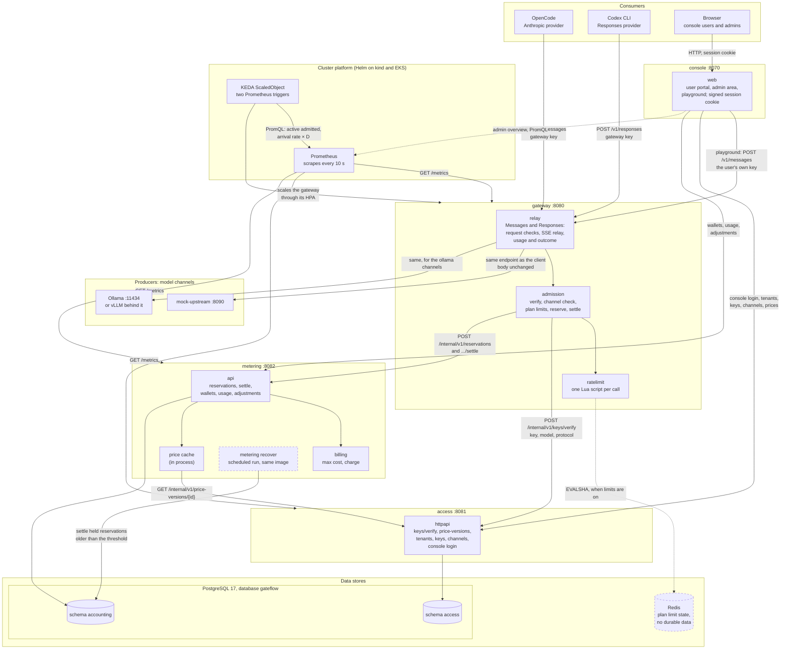

| Call | Authentication | Timeout and retries |
|---|---|---|
| tool → gateway, `/v1/messages` or `/v1/responses` | gateway key in `x-api-key` or `Authorization: Bearer` | none on the reply; upstream connect 10 s |
| gateway → access, verify | `Bearer ACCESS_INTERNAL_TOKEN`; the body names the protocol for Responses, and a missing protocol means Messages | 2 s, no retry |
| gateway → Redis, plan limits | the password in the Redis URL (`RATELIMIT_REDIS_URL`) | one bounded call per admitted call; an error or timeout refuses the call with 503. Tenants on an unlimited plan never call Redis |
| gateway → metering, reserve | `Bearer METERING_INTERNAL_TOKEN` | 2 s, retried once on a timeout, 5xx or connection error |
| gateway → metering, settle | `Bearer METERING_INTERNAL_TOKEN` | 2 s per attempt, up to 2 retries, with a fresh context |
| metering → access, price version | `Bearer ACCESS_INTERNAL_TOKEN` | 1 s; each version is cached for the life of the process |
| `metering recover` → accounting schema | the metering database role | one run at most 360 s (`activeDeadlineSeconds`); no overlapping runs |
| console → access, metering | the same internal tokens as the gateway and metering | as in `services/console/internal/backend` |
| console → gateway, playground | the signed-in user's own gateway key | as for any tool |
| gateway → upstream, Messages | none for the mock and Ollama; otherwise the channel's `credential_env` value as `x-api-key` | connect 10 s; forwards only `content-type`, `anthropic-version` and `anthropic-beta` |
| gateway → upstream, Responses | the same credential as `Authorization: Bearer` | connect 10 s; forwards only `content-type` |
| Prometheus → services, `GET /metrics` | none; scrapes inside the cluster only, never routed by the ingress | every 10 s, timeout 5 s |
| KEDA → Prometheus, two queries | none; inside the cluster | a query is empty unless every gateway target is up and fresh; KEDA then reports an error, never a zero, and the HPA does not scale down on it |

Every internal call carries `X-Request-Id`, the gateway's `req_<uuid>`, and every
internal error uses the body in [api/errors.md](../../api/errors.md).

Checked against: `services/gateway/main.go`, `services/gateway/internal/config/config.go`,
`.../admission/admission.go`, `.../admission/limit.go`, `.../admission/settle.go`,
`.../ratelimit/ratelimit.go`, `.../relay/relay.go`, `.../relay/protocol.go`,
`.../accessclient/client.go`, `.../meteringclient/client.go`,
`services/access/internal/httpapi/`, `services/metering/main.go`,
`services/metering/recover.go`, `services/metering/internal/accessclient/`,
`services/console/internal/config/config.go`, `services/console/internal/backend/backend.go`,
`services/console/internal/web/playground.go`, [api/access.yaml](../../api/access.yaml),
[api/metering.yaml](../../api/metering.yaml),
`deploy/helm/gateflow/templates/scaledobject.yaml`, `.../templates/recovery.yaml`,
`.../templates/redis.yaml`, `deploy/helm/gateflow/values.yaml`.

## 2. Domain design

### 2.1 From the domain to the services

The domain was analysed through the events of one coding session: an operator
registers channels and prices, an admin issues a key, the tool's calls are admitted,
held, relayed and settled, and the tenant reads its usage. Grouping those events by
the rules that change together gives three kinds of subdomain, five bounded
contexts and three services:

| Domain events | Subdomain | Kind | Bounded context | Service |
|---|---|---|---|---|
| CallAdmitted, CallRefused (429, 503), CallRelayed, OutcomeDecided | Model access and relay | core | Routing and relay | gateway |
| CostReserved, CallSettled, ReservationRecovered, WalletAdjusted | Usage accounting | core | Accounting | metering |
| UsageQueried | Usage reporting | supporting | Usage analytics | metering |
| TenantCreated, PlanAssigned, KeyIssued, KeyRevoked, ConsoleUserSignedIn | Tenant and access | supporting | Tenant and access | access |
| ChannelRegistered, PriceVersionPublished | Channel catalogue | supporting | Channel catalogue | access |
| (no business events) | Metrics, logs, password hashing, sessions | generic | none; shared libraries in `pkg/` and off-the-shelf tools | all |

Five contexts become three deployed services:

- **Tenant and access** and **Channel catalogue** share the access service. They are
  both configuration, change at the same slow rate, and are read together on every
  `keys/verify`.
- **Usage analytics** stays with **Accounting** in metering, because it is a read
  model of the accounting ledger.
- **Routing and relay** has no tables and the most traffic, so it is its own service
  and the only one that autoscales.

The proposal (section 5.3) planned this mapping; the code kept it.

### 2.2 Context map

Each arrow points from the upstream context (U), which publishes a contract, to the
downstream context (D), which uses it. The internal contracts are an *Open Host
Service* with a *Published Language*: [api/access.yaml](../../api/access.yaml),
[api/metering.yaml](../../api/metering.yaml) and [api/errors.md](../../api/errors.md).

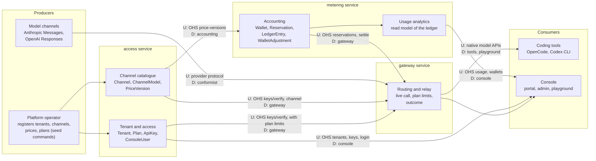

| Context | Service | Owns | Relationship |
|---|---|---|---|
| Tenant and access | access | `tenants`, `plans`, `api_keys`, `api_key_channels`, `console_users` | Upstream of the gateway through `keys/verify`, which returns the tenant's plan limits, and of the console |
| Channel catalogue | access | `channels`, `channel_models`, `price_versions` (immutable) | Upstream of the gateway (the channel in `keys/verify`) and of accounting (`price-versions`) |
| Routing and relay | gateway | no tables; the live call, and limit counters in Redis | Downstream of access and accounting. Conformist to the provider protocols: the body goes upstream unchanged, and the wire types in `pkg/protocol/` are a shared kernel of technical types only, with no business rules |
| Accounting | metering | `wallets`, `reservations`, `ledger_entries`, `wallet_adjustments` | Upstream of the gateway through reserve and settle |
| Usage analytics | metering | no tables of its own; reads `reservations` | Upstream of the console through `usage` and `wallets` |

The `test/archtest` package fails the build when one service imports another
service's packages, so these boundaries hold in the code as well as at runtime.

### 2.3 Aggregates

Each box is an aggregate root with the entities and value objects it owns. The
invariants are enforced by the database (check constraints, unique keys, triggers),
so they hold for every replica and for the recovery job.

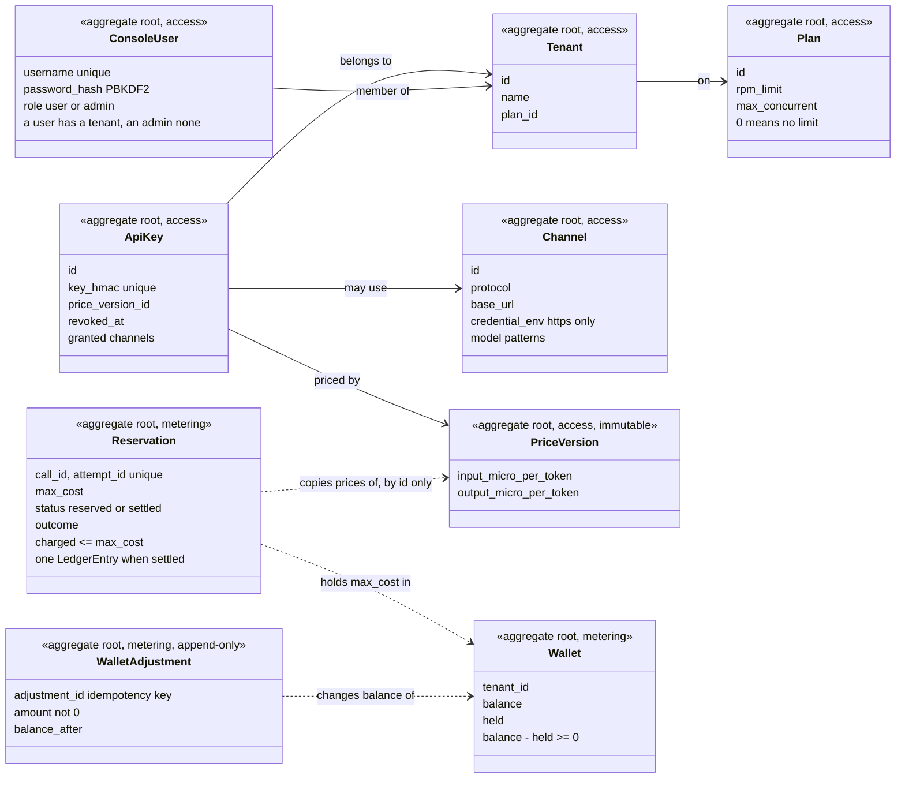

Solid arrows are references inside one schema; dotted arrows cross the service
boundary or link by value only, with no foreign key.

Checked against: `services/access/migrations/`, `services/metering/migrations/`,
`services/access/internal/store/queries.go`, `test/archtest/`, `api/*.yaml`,
`services/access/internal/seed/seed.go`, proposal section 5.3.

## 3. Physical view: local stack

The local stack is `deploy/compose/compose.yaml`. Every port binds to `127.0.0.1`
only. An arrow means "starts after": the lower box waits until the upper one is
healthy, or, for the seed steps, has finished.

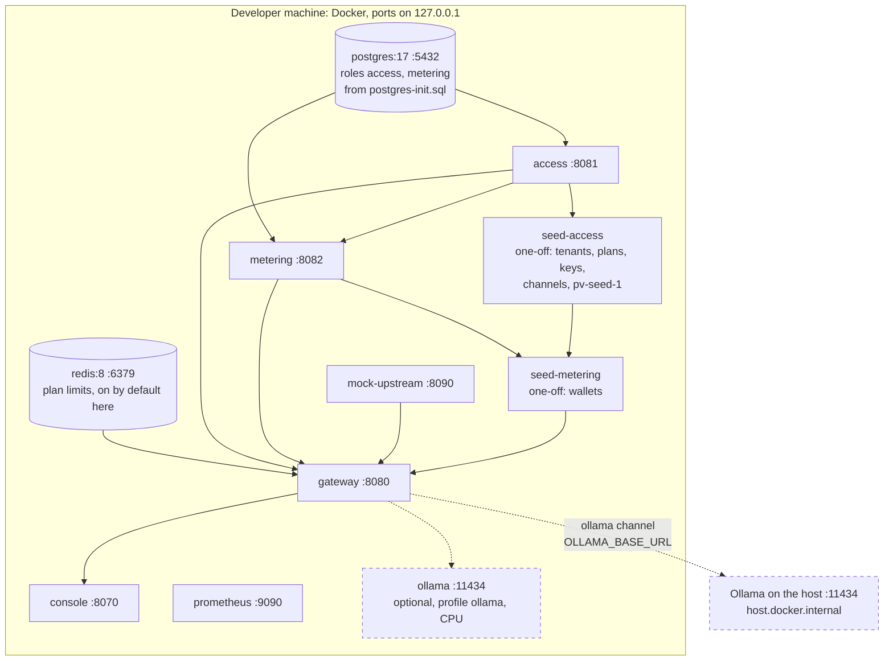

- Each service image is built from one `deploy/docker/Dockerfile` and runs as a
  distroless, non-root binary. The binary checks its own `/healthz` for the health
  checks, because the image has no shell or curl.
- In compose the gateway enforces plan limits (`RATELIMIT_ENABLED` defaults to
  `true`); `SEED_PLANS` assigns plans to tenants, and every other tenant stays on
  the `unlimited` plan.
- Containers stop with a 15 s grace period, longer than the services' 10 s drain.
- The seed steps run on every `up` and change nothing when the data exists. Keys are
  printed only in the `seed-access` log.

Checked against: `deploy/compose/compose.yaml`, `deploy/compose/postgres-init.sql`,
`deploy/docker/Dockerfile`, `pkg/server/server.go`.

## 4. Physical view: cloud

Terraform creates the environment for each cloud day and destroys it the same day.
The view shows the configuration of the runs on 18 October and the recording on
19 October ("cfg-D", set at install time over `values-aws.yaml`), and marks what
the repository defaults differ in. Plan limits and recovery are built and accepted
on kind, but never ran on EKS.

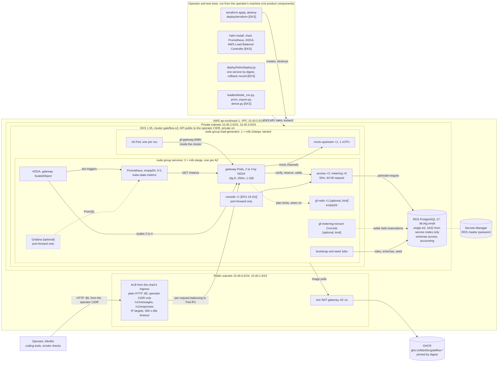

| Namespace (release) | Workload | Replicas | CPU / memory | Node group |
|---|---|---|---|---|
| `gateflow` (`gf`) | gateway | 2–4, KEDA; T = 575 per Pod, D = 21.0072 s, scale-down window 60 s | 250m / 1 GiB, request = limit | services |
| | access | 3 | 50m / 64 Mi request, 256 Mi limit | services |
| | metering | 5 | 50m / 64 Mi request, 256 Mi limit | services |
| | console | 1 (19 October) | 20m / 32 Mi request, 128 Mi limit | services |
| | gf-redis [optional] | 1 | 50m / 64 Mi request, 128 Mi limit | services |
| | gf-metering-recover [optional] | CronJob, default every 5 min, threshold 30 min | 10m / 32 Mi request, 64 Mi limit | services |
| | mock-upstream | 1 | 1 vCPU / 1 GiB request, 2 GiB limit | load-generator |
| | k6 Job | one per run | 4 CPU / 16 GiB | load-generator |
| `monitoring` (`prometheus`) | Prometheus server, kube-state-metrics | 1 each | 100m / 256 Mi (server) | services |
| `keda` (`keda`) | KEDA operator, metrics API server | 1 each | chart default | services |
| `kube-system` | AWS Load Balancer Controller, CoreDNS, VPC CNI, kube-proxy | chart or EKS default | — | services; CNI and kube-proxy on every node |

- **Repository defaults against cfg-D.** `values-aws.yaml` gives each gateway Pod
  1 vCPU and 2 GiB, with the provisional T = 70 and D = 20 s. The chart default for
  access and metering is one replica each. cfg-D (250m gateway Pods, access 3,
  metering 5, T 575, D 21.0072 s from the single-Pod calibration) was set at
  install time; its values are recorded in the evidence bundles.
- **Optional parts.** `ratelimit.enabled` adds `gf-redis` and turns limits on in
  the gateway. `recovery.enabled` adds the CronJob. Both are off by default, so an
  install without them behaves as on the cloud days.
- **Probes.** Readiness, liveness and startup probes are now set from
  `probes.*`, with a 1 s timeout by default, the same as in the cloud runs.
- **Graceful shutdown.** A gateway Pod has an 85 s grace period: a 5 s preStop, a
  10 s drain, up to 60 s for open streams and a 10 s margin.
- **Pod placement.** Every product Pod selects `gateflow.io/workload=services`;
  mock-upstream and k6 select `gateflow.io/workload=load-generator` and tolerate
  its taint.
- **Ingress limits.** The chart refuses to render for AWS without
  `ingress.inboundCidrs`, and refuses any `/0` unless `ingress.allowAnySource=true`.
  `/metrics`, `/healthz` and `/readyz` return 404 through the ALB.
- **Operator only.** bibi45c runs every operator tool from an allowed IP. GitHub
  holds no AWS credentials, and no workflow deploys to AWS.

Checked against: `deploy/terraform/` (`main.tf`, `variables.tf`, `terraform.tfvars`,
`modules/*`), `deploy/helm/gateflow/` (`values.yaml`, `templates/*.yaml`),
`deploy/helm/values-aws.yaml`, `deploy/helm/monitoring/`, `deploy/helm/README.md`,
`deploy/helm/deploy.py`, `loadtest/kube_run.py`, and the evidence bundles of 17 and
18 October (`day*-config/`: `helm-list.txt`, `nodes.json`, `helm-values-gf.json`).

## 5. Persistence view

One PostgreSQL database, `gateflow`, holds two schemas:

- **Ownership.** Each schema is owned by its service's own login role.
- **Isolation.** Every schema, `public` included, is closed to every other role. The
  access role cannot read accounting tables, and the reverse.
- **Migrations.** Each service applies its own migrations at startup through
  `pkg/pgmigrate`. Every migration only adds tables or defaulted columns, so the
  previous image still starts on the new schema.
- **No cross-schema links.** There are no cross-schema foreign keys or joins;
  `tenant_id` matches between the schemas by value only.

Redis holds only the plan-limit counters, which may be lost (section 5.3).

### 5.1 Schema access (role access): 8 tables

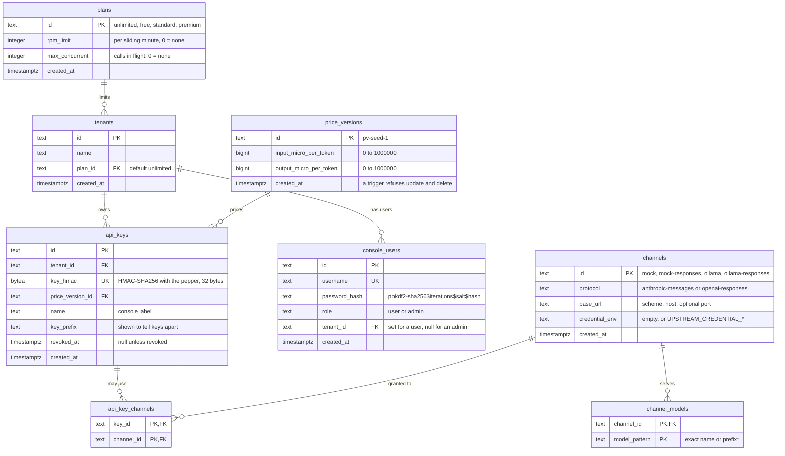

- The raw key is never stored. A lookup hashes the presented key and uses the unique
  index on `key_hmac`. Revocation takes effect on the next call, because the gateway
  keeps no key cache.
- A credential is allowed only over `https`: a check constraint refuses a
  `credential_env` on an `http` channel.
- `keys/verify` joins the key, its tenant and the tenant's plan, so the gateway
  learns the limits with the key check and needs no extra call.

### 5.2 Schema accounting (role metering): 4 tables

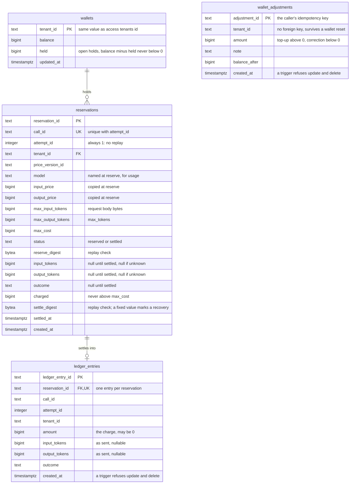

- Check constraints keep a `reserved` row free of settlement values, and require a
  `settled` row to have an outcome, a charge and a time.
- `ledger_entries` and `wallet_adjustments` are append-only: a correction is a new
  row.
- Index `reservations (tenant_id, created_at DESC)` serves the console's usage
  pages.
- **Concurrency.** Reserve updates the wallet row in the same transaction that
  inserts the reservation, so two reserves on one wallet serialise on that row.
  Settle and recovery lock the reservation row (`SELECT … FOR UPDATE`) before they
  write the ledger entry and release the hold.

### 5.3 Redis: plan limit state

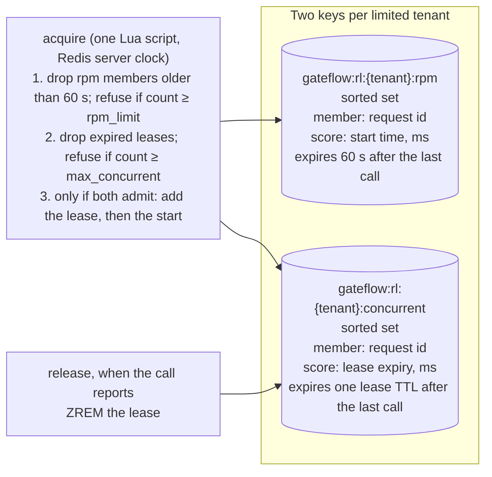

- The hash tag `{tenant}` keeps both keys of a tenant in one slot of a Redis cluster.
- The script runs atomically on the Redis server's clock, so replicas never disagree
  on time and never admit past a limit together.
- A lease whose gateway died is dropped when it expires: `RATELIMIT_LEASE_TTL`,
  10 minutes by default.
- The state is not durable. The chart's `gf-redis` keeps it in an `emptyDir`, so a
  restart starts every window and lease from zero.

Checked against: `services/access/migrations/0001_init.sql` to `0004_plans.sql`,
`services/metering/migrations/0001_init.sql`, `0002_console.sql`,
`services/access/internal/store/queries.go`,
`services/metering/internal/store/reservations.go`, `.../store/recover.go`,
`services/gateway/internal/ratelimit/ratelimit.go`, `deploy/compose/postgres-init.sql`,
`deploy/helm/gateflow/files/bootstrap.sql`, `deploy/helm/gateflow/templates/redis.yaml`,
`pkg/pgmigrate/pgmigrate.go`.

## 6. Use case design: bill one streamed call

The first representative use case is **UC6, reserve and settle usage**, as it runs
inside **UC4**, one streamed `POST /v1/messages` call. The `/v1/responses` call
follows the same steps; its differences are listed below the sequence. It crosses all
three services and both schemas. It carries most of the billing rules: the
idempotent internal calls, the outcome rule, the charge rule and recovery.

### 6.1 Classes

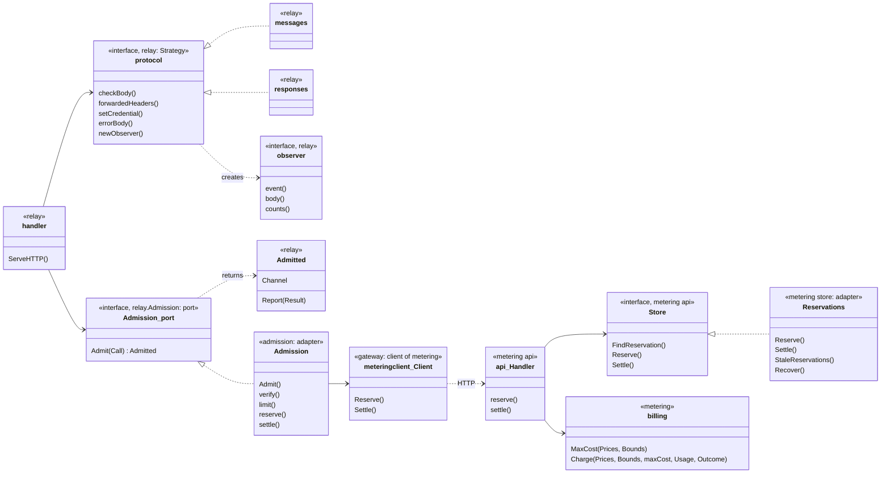

Design patterns, as they appear in the code:

- **Strategy:** `relay.protocol`, one implementation per wire protocol (`messages.go`,
  `responses.go`). The size check, admission, event cap, failure handling and outcome
  rule are shared.
- **Ports and adapters:** the relay depends only on the `relay.Admission` interface,
  which `admission.Admission` implements. Likewise, the metering API depends on the
  `api.Store` and `api.PriceSource` interfaces, implemented by the PostgreSQL store
  and the access client. Tests swap in stand-ins.
- **Anti-corruption client:** each caller writes its own client of another service's
  contract (`gateway/internal/accessclient`, `.../meteringclient`,
  `metering/internal/accessclient`), so no service imports another's types.
- **Idempotent receiver:** reserve and settle return the recorded result for a replay
  with the same content, and refuse different content with 422.
- **Callback:** `Admitted.Report` is called exactly once when the relay ends; it
  frees the concurrency lease and settles.

### 6.2 Sequence

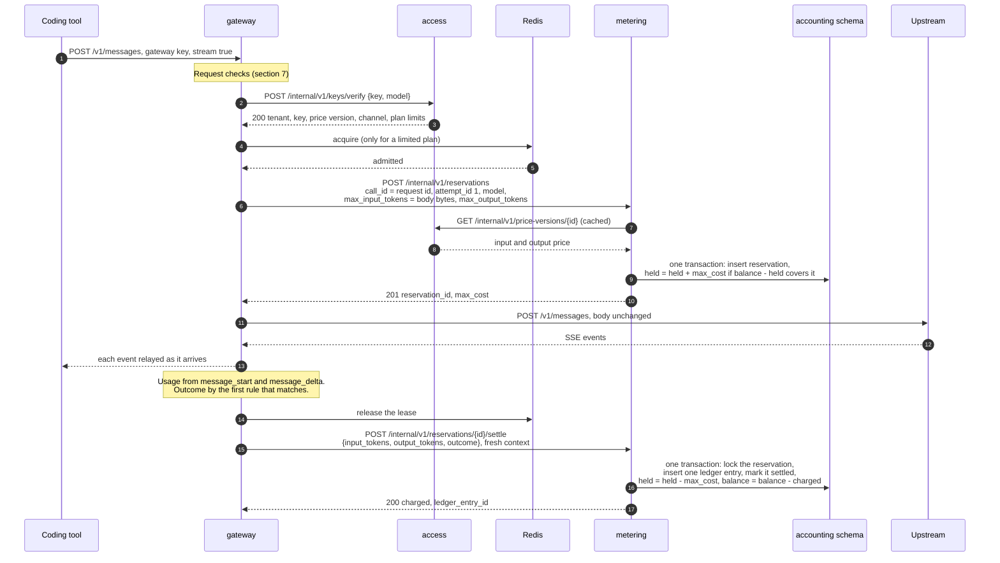

### 6.3 The same flow on `/v1/responses`

`POST /v1/responses` runs the same admission, relay and settle steps; only the wire
format differs:

| Step | `/v1/messages` | `/v1/responses` |
|---|---|---|
| Verify | protocol left out, so `anthropic-messages` | protocol `openai-responses`, so a `*-responses` channel |
| Output bound held | `max_tokens`, required, 1 to 32,768 | `max_output_tokens`, 1 to 32,768; when absent, the gateway sets it to 32,768 in the body it forwards and holds that |
| Refused before admission | — | `previous_response_id`, with 400: the gateway keeps no response state |
| Usage source | `message_start` and `message_delta`, cache tokens added to input | `response.completed` usage; cached input tokens are part of `input_tokens` |
| Public errors | Anthropic error body | OpenAI error body |

### 6.4 Reservation states

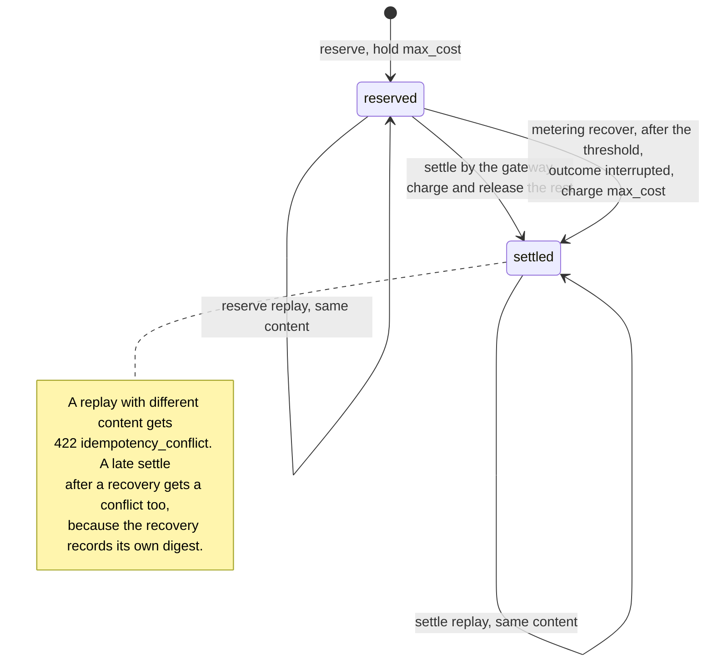

### 6.5 Charge rule

`max_cost = max_input_tokens × input price + max_output_tokens × output price`. At
settlement, an unknown count is replaced by its maximum, and
`charged = min(max_cost, input × input price + output × output price)`.
`upstream_error` and `not_dispatched` charge 0. With `pv-seed-1` (3 and 15
micro-units per token), a call with 6,328 input and 449 output tokens is charged
6,328 × 3 + 449 × 15 = 25,719.

| Outcome | When (first rule that matches) | Charge |
|---|---|---|
| `not_dispatched` | no upstream request was sent | 0 |
| `completed` | `message_stop` arrived, or a full 2xx body was read | counts as reported |
| `client_cancelled` | the client disconnected first | unknown counts at their maximum |
| `upstream_error` | the upstream answered non-2xx before any output | 0 |
| `interrupted` | anything else, such as a dropped stream; also every recovery | unknown counts at their maximum |

**Recovery** (#154, #155). A gateway that dies before it settles leaves the hold in
place. `metering recover` lists reservations still `reserved` after `--older-than`
(chart default 30 minutes, every 5 minutes), oldest first, at most `--limit`. It
settles each one through the same transaction as a settle request, as `interrupted`
with unknown counts, so it charges `max_cost`. It logs one JSON line per reservation
and fails the run if any recovery fails.

Checked against: `services/gateway/internal/relay/relay.go`, `.../relay/protocol.go`,
`.../relay/messages.go`, `.../relay/responses.go`, `.../relay/result.go`,
`services/gateway/internal/admission/`, `services/gateway/internal/meteringclient/client.go`,
`services/metering/internal/api/api.go`, `services/metering/internal/billing/billing.go`,
`services/metering/internal/store/reservations.go`, `.../store/recover.go`,
`services/metering/recover.go`, [api/metering.yaml](../../api/metering.yaml).

## 7. Use case design: admit one call

The second representative use case is **admission**: every call is checked in the
order verify → channel check → plan limits → reserve, and only a call with a
confirmed reservation reaches the upstream. A refused call leaves no reservation and
no ledger entry. It carries the multi-tenant rules: key and model permission, fair
use by plan (#157), and the wallet as the spending limit.

### 7.1 Classes

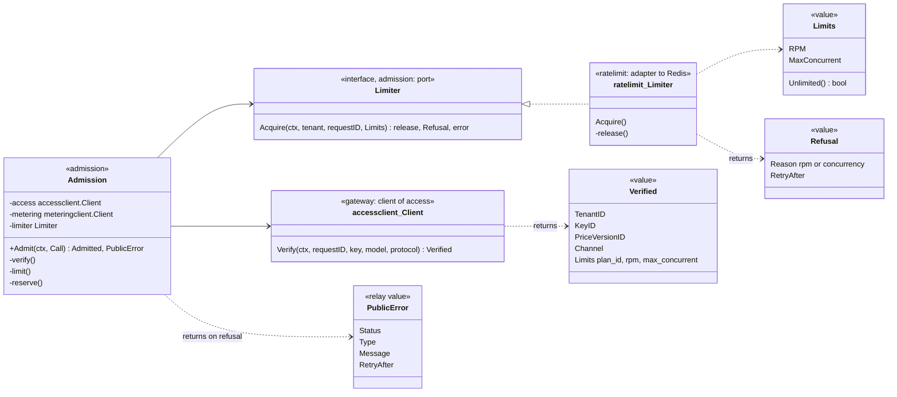

The limiter is optional: with `RATELIMIT_ENABLED=false` the gateway has no
`Limiter`, and `limit()` admits without asking, which is the behaviour before #157.

### 7.2 Sequence, with the refusal paths

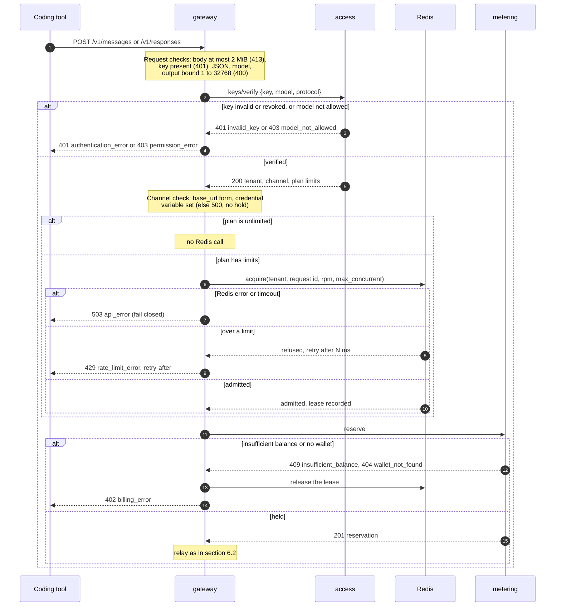

| Where | Internal answer | What the tool gets |
|---|---|---|
| verify | 401 `invalid_key` | 401 `authentication_error` |
| verify | 403 `model_not_allowed` | 403 `permission_error` |
| plan limits | over `rpm_limit` or `max_concurrent` | 429 `rate_limit_error` with `retry-after`; the message names the gateway's own limit, so a client can tell it from an upstream 429 |
| plan limits | Redis unreachable or slow | 503 `api_error`: admitting would let a tenant exceed its limits |
| reserve | 409 `insufficient_balance`, 404 `wallet_not_found` | 402 `billing_error` |
| verify or reserve | timeout, unreachable, `dependency_unavailable` | 503 `api_error` |
| anything else | any other code | 500 `api_error`, logged |

Checked against: `services/gateway/internal/admission/admission.go`, `.../admission/limit.go`,
`.../admission/channel.go`, `services/gateway/internal/ratelimit/ratelimit.go`,
`services/gateway/internal/accessclient/client.go`, `services/gateway/internal/relay/relay.go`,
[api/access.yaml](../../api/access.yaml), [api/errors.md](../../api/errors.md).

## 8. Delivery pipeline

Six GitHub Actions workflows, plus Dependabot. Every pull request runs about 24
checks; a push to `main` runs them again and publishes the images.

```mermaid
flowchart LR
  DEV["Branch and PR<br/>one issue per PR"]
  subgraph ci["CI on every pull request and push to main"]
    TS["Tests<br/>repository tests, 3 OSes"]
    GO["Go<br/>gofmt, vet, test, build, 3 OSes"]
    IT["Go integration, ubuntu<br/>PostgreSQL + Redis, no skips,<br/>statement coverage"]
    CS["Compose smoke<br/>health endpoints, end-to-end"]
    HK["Helm kind smoke (chart paths)<br/>lint, render tests, install, ingress,<br/>upgrade, deploy one service, roll back"]
    TF["Terraform validation<br/>mocked tests, no AWS calls"]
    IB["Service images<br/>build 5 images, no push"]
    SEC["Security<br/>govulncheck; Trivy on 5 images;<br/>Trivy config on Terraform, chart, Dockerfile;<br/>SARIF to code scanning"]
  end
  IF["Issue format check<br/>on issue events"]
  DB["Dependabot<br/>weekly: Go modules, Actions, Docker"]
  MG["Squash merge to main<br/>by the integrator"]
  PUB["Publish images<br/>on main and v* tags<br/>tag = commit SHA, digest recorded"]
  GHCR[("GHCR")]
  CHART["Chart default imageTag<br/>set in a reviewed PR"]
  subgraph cd["Delivery, run by the operator"]
    TFA["terraform apply<br/>per cloud day"]
    INS["helm install<br/>values-aws + overrides"]
    DPL["deploy.py: one service by digest,<br/>smoke, record"]
    RB["deploy.py rollback<br/>from the record"]
    TFD["terraform destroy,<br/>leftover check"]
  end

  DEV --> ci
  DB --> DEV
  ci --> MG
  MG --> PUB --> GHCR
  PUB --> CHART
  GHCR --> INS
  TFA --> INS --> DPL --> RB
  RB --> TFD
```

- Required checks and the merge rules are in
  [CONTRIBUTING.md](../../.github/CONTRIBUTING.md); test levels and evidence are in
  [docs/testing.md](../testing.md).
- Scanners are installed at a pinned version with a checksum check, not through
  third-party actions. Accepted findings are listed with a reason and an expiry date
  in [.trivyignore](../../.trivyignore).
- There is one cloud environment, created and destroyed per experiment day. The
  owner approves every cloud action; no workflow holds AWS credentials.

Checked against: `.github/workflows/tests.yml`, `helm.yml`, `images.yml`,
`security.yml`, `terraform.yml`, `issue-check.yml`, `.github/dependabot.yml`,
`.trivyignore`, `deploy/helm/deploy.py`, `deploy/terraform/README.md`.

## 9. Deviations from the proposal

Recorded in #18, the gate record (#20), the [feasibility plan](../feasibility-plan.md)
and the issues named in each row.

| Proposal | As built | Why |
|---|---|---|
| Transactional outbox, SQS and idempotent consumers for usage views (sections 5.1, 5.4) | Reservation and settlement in PostgreSQL transactions only; the console reads usage straight from `reservations`; no outbox, no queue | Kept S1 small; not added later |
| A pending reservation waits for recovery when usage is unknown | An unknown count is charged at its maximum at settle. A hold that is never settled is recovered by `metering recover` and charged `max_cost` (#155) | One charge rule for every lost count |
| Redis for limits and the key cache | Redis holds the per-tenant plan limits (#157), optional in the chart, on in compose. No key cache, so revocation is immediate | Limits must hold across replicas; a key cache would delay revocation |
| Keys and channels created through APIs (UC1, UC2) | The console creates and revokes keys and adjusts wallets through the internal APIs (#137). Tenants, channels, price versions and plans are written by seed commands; the console only lists them | The write APIs for the catalogue were not built |
| Separate prices for cache and reasoning tokens | Cache tokens are charged at the full input price, on Messages and on Responses (where cached tokens are inside `input_tokens`); thinking tokens arrive in `output_tokens` | One price pair per version |
| Conversation state through the gateway | `/v1/responses` is stateless: `previous_response_id` is refused, and clients resend the conversation | The gateway keeps no response state |
| Per-caller internal identities | One shared token per callee; metering trusts the gateway's `tenant_id` and `price_version_id` | mTLS and workload identity were out of scope |
| Claude Code and Codex CLI as the acceptance clients (UC3) | OpenCode on Messages; Codex CLI on Responses (guide #103) | Claude Code needs a Claude service |
| Aurora, Argo CD, Cognito and CloudFront (section 5.5) | Plain RDS PostgreSQL in Terraform, images in GHCR instead of ECR, and the operator-run `deploy/helm/deploy.py` instead of Argo CD: one service by digest, rolled back from its record (#111) | Cost and time |
| Distributed tracing (UC15) | Prometheus metrics and JSON logs only (`docs/observability.md`) | Tracing is optional and its overhead unmeasured |
| Public HTTPS ingress (section 5.5) | The ALB listens on plain HTTP, with no TLS. It admits only `ingress.inboundCidrs`; the chart refuses an empty list, and any `/0` unless `ingress.allowAnySource=true` (#116) | HTTPS has not landed; the source allow-list is the stopgap, and keys still cross the internet in clear |
| Prometheus and one Grafana dashboard (section 5.5) | Prometheus keeps 6 h on an `emptyDir`; `loadtest/prom_export.py` exports each run's series before teardown. The dashboard (#115) is opt-in | Disposable environments |
| 1 vCPU and 2 GiB per gateway Pod (section 5.6) | `values-aws.yaml` keeps 1 vCPU and 2 GiB. The cloud runs used 250m and 1 GiB per Pod (cfg-D), set at install time | Owner's decision on 17 October; the results describe 250m Pods and do not transfer to 1 vCPU |
| Generator and simulator compute isolated from the relay nodes (section 5.6) | Isolated from the services nodes, but k6 and mock-upstream share one load-generator node: c6i.xlarge by default (`generator_instance_type`), m6i.2xlarge in the cloud runs | Cost; the runs checked that the generator was not the limit |
| A calibrated per-Pod admission cap C, with capacity rejections (section 5.6) | No admission cap. C is measured in the single-Pod calibration (`loadtest/derive.py`) and sets the KEDA target T = floor(0.7 × C); nothing enforces C | The capacity gate is not built |
| Fallback, 8 replicas, weighted routing, CSV export (UC11–UC14) | Not built | Should and Could items |
| Real-model capacity tests | A kit for vLLM on a GPU node (#147–#149) is merged; the cloud run is deferred because the GPU instance quota was 0 | AWS quota |
