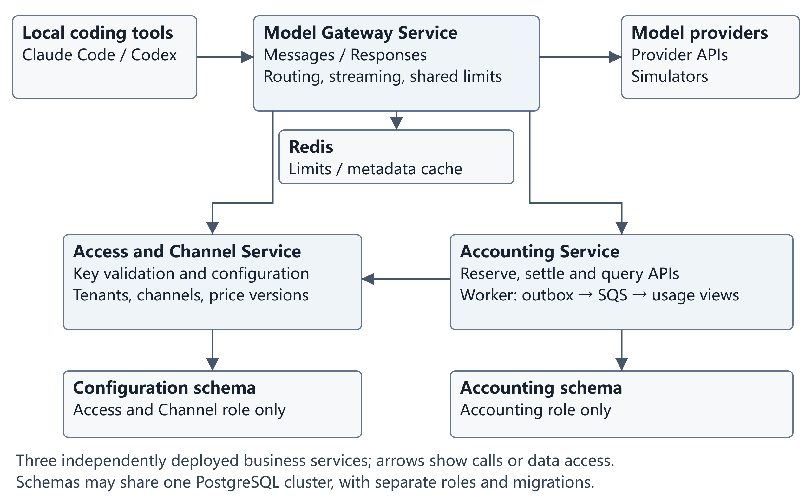

# FlowGate Project Proposal

> Repository copy of the submitted proposal, revision 1.1. Member names are replaced by
> GitHub usernames; the content is otherwise unchanged.

SWE5001 Architecting Scalable Systems Practice Module | Team 1 | 6 October 2026 | Revision 1.1

## 1 Project Title

**FlowGate A Scalable Model API Gateway for Local Coding Agents**

FlowGate will provide model APIs for developers using local coding tools such as Claude Code and Codex. Developers will configure their existing tools with the gateway address, a gateway key and a supported model. The project will measure how gateway capacity changes as concurrent requests increase. It will also test tenant isolation, failure handling and automated deployment. The proposed effort is 50 person-days for four members.

The main deliverable will be the API service, supported by a small management console and a reference client built by the team. Acceptance tests will cover client compatibility, performance and system capacity.

## 2 Project Sponsor

This is a student practice project with no external sponsor.

## 3 Project Members

| Member | Proposed responsibility |
|---|---|
| @bibi45c (M1) | Model Gateway Service, routing, native protocols and simulator |
| @liutongyaocn-web (M2) | Accounting Service, reservations, ledger, events and recovery |
| @agneshephzibahroche (M3) | Access and Channel Service, minimal console and client integration |
| @KaenBin (M4) | Cloud infrastructure, delivery pipeline, observability and scaling tests |

The four members are listed by their GitHub usernames. M1 to M4 are identifiers used in the work breakdown. Each member is expected to contribute approximately 12.5 person-days. The responsibilities are proposed; individual assignments will be agreed by the team.

## 4 Overview

### 4 1 Context and business problem

Developers and small teams may use local coding tools such as Claude Code and Codex CLI, choosing model services to suit their tasks and budgets. They need straightforward API access, clear model permissions and quotas, and visible usage records. Managing credentials and configuration separately for each service requires repeated setup when changing tools or adding model channels. It also makes overall usage harder to track.

A shared model API entry point can simplify access, but several practical issues remain. An endpoint that returns text may not support the conversation history, streaming and tool calls required by a coding client. Users also need to distinguish exhausted quotas, rate limits and provider failures so that they can respond appropriately. For team use, administrators need to assign model permissions and quotas to members and review the corresponding usage records.

As user and request counts grow, the shared entry point also faces capacity pressure. Coding tasks may keep connections open for long periods, while each model service has its own request limits and available capacity. Heavy use by one user or a slow channel may occupy shared resources and increase waiting times for others. The system therefore needs to limit resource use by individual users and channels and support additional gateway instances as load grows.

This project will design and implement **FlowGate**, a shared model API gateway for local coding tools. It will connect authorised model service channels and provide authentication, quota control, model routing, request forwarding and usage queries. The project will evaluate horizontal scaling, reuse of shared services across clients and channels, and user isolation under heavy load and channel failures.

Experiments will progressively increase concurrent requests under fixed configurations. They will compare throughput, response latency, success rates and resource use across different gateway instance counts, and measure the effect of heavy users on other users. Large-scale load experiments will use a controlled model simulator. Real model services will be used to verify client compatibility. Results will be reported separately to distinguish gateway capacity from upstream service limits.

### 4 2 Proposed solution and user experience

FlowGate will provide model APIs and a small management console. Developers will continue working in their local coding tools. The console will support access configuration, gateway key management and usage queries. Platform operators will register authorised model channels, including their endpoints, supported protocols, models and accounting prices.

The main user workflow is as follows:

1. **Obtain access.** A tenant administrator assigns available models and quotas to an individual or team and creates a gateway key. Developers use this key to access authorised models without receiving each upstream channel's credentials.

2. **Configure the local tool.** Following the integration guide, developers configure the FlowGate API endpoint for the required protocol, gateway key and model in a supported client. Compatibility information will list tested client versions, models and features to help users choose a supported configuration.

3. **Submit a coding task.** Developers submit tasks in their local tools as usual. FlowGate checks identity, model permissions, quota and request limits. It selects a channel that supports the requested model and protocol, reserves simulated quota for the request and forwards it. The platform will not silently replace the selected model to reduce cost.

4. **Receive results and continue execution.** FlowGate streams model output to the client. If the model requests a tool call, the client executes it within its local permissions and sends the result back through FlowGate. This continues until the task finishes or the user stops it.

5. **Review usage and handle errors.** Users can view their tenant's usage, remaining quota and request status in the console. Failed requests will return distinguishable errors and a request identifier so that users can identify configuration, quota, rate-limit or upstream service problems. Requests awaiting usage confirmation will show a pending status.

File edits and command execution will remain in the local client. Code excerpts, tool arguments and execution results sent to the model may pass through the gateway. Operational logs will exclude request bodies and credentials. The client will remain responsible for its own permissions and network connections outside the model API.

The integration targets are Claude Code CLI and Codex CLI. Acceptance for each client will include a complete task using a real model, covering conversation continuation, a model-requested tool call, local execution, return of the tool result and a final response. The course prototype will use simulated quota to validate quota control and usage records. Real payments and a complete commercial billing system are outside its scope.

### 4 3 Platform ecosystem and reuse

| Platform element | Application to FlowGate |
|---|---|
| Seed | A catalogue entry describing an authorised model channel, its owner, protocol and capabilities |
| Producers | Model service or channel owners contributing approved model access |
| Consumers | Developers using local coding tools and application developers |
| Core interaction | Register a channel, grant access, invoke a model and record usage |
| Magnet | Shared model access, consistent limits and visible usage |
| Toolbox | Documented APIs, configuration examples and a small reference client |
| Matchmaker | Model selection and routing to a compatible channel |

Operators will approve channel registration. A channel owner supplies its endpoint, protocol, model capabilities and price version; the platform supplies shared access control, limits and usage records [C4]. Team members will represent these roles in the prototype. Self-service registration is outside the scope.

The reuse experiment will connect a second local tool and add a compatible channel using the existing access control and accounting services. The team will also build a small command-line reference application. It will read a selected test file, request a summary from the model and display incremental output, completion status and the gateway request identifier. The application will have its own source code and tests. The reuse record will separate client-specific work from shared authentication, limits, routing and accounting. For the reference application and one added channel using an existing protocol, it will list changed files, actual hours and regression results. A task comparison will show which shared capabilities would otherwise need to be built; any estimate of that extra effort will be labelled as an estimate.

### 4 4 Implementation approach

The team will build the relay and domain rules, using maintained libraries, identity components, dashboards and infrastructure modules where suitable. Reused material will be credited. An initial feasibility test will check one complete local workflow, persistent accounting records and streaming through the ingress. Work on the second protocol will begin after this test.

FlowGate will initially forward native protocols to compatible upstreams. Conversion between arbitrary model protocols is outside the scope. A controllable simulator will support repeatable load and failure experiments. Client acceptance tests will use real models, authorised credentials and an agreed budget. If these resources are unavailable, client acceptance will remain pending. Simulator results will be reported separately from real-provider compatibility and capacity.

## 5 General Architecture

### 5 1 Logical components and design decisions

The backend will use Go, with React and Vite for the small management console. FlowGate will implement three business microservices: the Access and Channel Service, the Model Gateway Service and the Accounting Service. Each will run in its own container image and Kubernetes Deployment, with a separate service endpoint, tests, configuration and release version. The gateway will scale independently of the two supporting services.

Local tools will call the gateway's Messages or Responses endpoint. The gateway will obtain authorised key and channel metadata through the Access and Channel Service API, applying the existing cache bounds. Before calling a model, it will obtain a durable reservation through the Accounting Service API. The gateway will have no direct SQL access to either service's tables. Redis will support gateway limits and bounded metadata caches.

The Accounting Service will own reservations, settlement, the ledger, outbox publication and usage projections. Its API and background worker may use separate Deployments for their different workloads, but both belong to the same service and data boundary. The worker will publish committed events to SQS and consume them idempotently to update usage views [R1, R2]. This worker, the simulator and managed cloud products are not counted as additional business microservices.

Figure 1. Three business microservices communicate through APIs. Accounting owns its background worker and durable records.

| Decision | Rationale and trade-off |
|---|---|
| Implement three independently deployed business services | Gateway traffic scales independently; internal API latency and partial failures require contract and fault tests |
| Provide two native protocol paths | Reduces translation work; compatibility remains model and version dependent |
| Preserve tool calls and stream events | Enables complete local workflows; text-only testing is insufficient |
| Keep reservations and settlement in PostgreSQL | Preserves wallet authority; admission adds latency and contention |
| Use an outbox and idempotent consumers | Usage events recover after queue outages; projections are asynchronous |
| Return failures without replay in the core scope | Avoids duplicate execution; optional fallback requires extra cost and protocol checks |
| Execute local tools in the client | Reuses the harness workflow; model content still traverses the gateway |

Accounting will cover the simulated charges and supported request types defined for this prototype. Database writes will occur before invocation and at settlement, rather than for every output chunk. Tests will measure transaction latency and contention. Full commercial billing and reconciliation are outside the scope.

### 5 2 API contracts and client compatibility

| Client target | Model API | Initial upstream strategy |
|---|---|---|
| Claude Code CLI | Anthropic Messages at POST /v1/messages | A Claude service accepting the native protocol |
| Codex CLI | OpenAI Responses at POST /v1/responses | A model service accepting the native protocol |

Codex integration will use Responses, including its request fields and stream events [R6]. The Claude Code path will preserve the required Messages headers, fields and events [R7]. This path will use Claude services, as Anthropic does not support routing Claude Code to non-Claude models through a gateway [R8]. Client configuration will follow the gateway settings documented for the selected versions [R5, R7].

The initial transport will be HTTP streaming with server-sent events (SSE). The compatibility matrix will list supported fields and model names. It will also define authentication, stream completion, cancellation, follow-up turns and errors. Token counting, WebSockets and advanced features will require separate selection and testing. Each upstream must support the features offered to its client.

Compatibility tests will check that each tool-call identifier remains linked to its result and conversation context. The initial HTTP path will resend the required conversation input. Provider-side continuation identifiers will be rejected unless their tenant ownership is verified and routing remains tied to the correct channel. Unsupported features will return a clear error.

For each selected client version, the matrix will specify model aliases, context and output limits, reasoning options, terminal events and authentication headers [R6, R7]. FlowGate will validate gateway credentials locally and remove client authentication headers before adding the server-held provider credentials. Errors will distinguish invalid credentials, unsupported requests, tenant limits, gateway capacity and upstream failures. Tests will check protocol error events, retry hints and client retries, with each new invocation separately recorded.

### 5 3 Bounded contexts and microservice collaboration

| Bounded context | Implementing microservice | Responsibility and data ownership |
|---|---|---|
| Tenant and access; channel catalogue | Access and Channel Service | Owns Tenant, ApiKey, Channel, Capability and immutable PriceVersion records; exposes authenticated configuration and key-validation APIs |
| Routing and relay | Model Gateway Service | Owns RoutePolicy and the live invocation workflow; exposes model APIs, selects compatible channels and forwards streams; durable invocation and attempt records are held by Accounting |
| Accounting; usage analytics | Accounting Service | Owns Wallet, Reservation, Attempt, LedgerEntry, outbox and tenant usage views; exposes reservation, settlement, recovery and query APIs |

The five logical contexts map to three deployed business services. Closely related configuration contexts share one service; usage projections remain within Accounting because they are derived from its ledger. Each service can be built, deployed and restarted without rebuilding the others. A shared repository is acceptable, but services will not call each other's domain code in-process.

The service APIs form documented contracts, corresponding to Open Host Service and Published Language in DDD. Provider adapters remain inside the Model Gateway Service. Requests between services will use authenticated internal HTTP APIs with timeouts, caller permissions and validated tenant context. The console will call Access and Channel for configuration and Accounting for tenant-scoped quota and usage queries; both APIs will verify the signed-in identity. User-supplied tenant headers will not grant access.

For the course deployment, Access and Channel and Accounting may share one PostgreSQL cluster to control cost. Each will use its own schema and database role, own its migrations, and have no permission to read or write the other's tables. There will be no cross-service SQL joins or shared database transactions. Sharing infrastructure does not transfer data ownership. The gateway will receive only the approved configuration, price version and credential reference needed for a request.

Reservation and settlement APIs will use the same invocation and attempt identifiers for repeated internal calls. A duplicate call with the same payload returns the recorded result; conflicting reuse is rejected. Accounting resolves and validates the selected immutable price version through the Access and Channel API, caching versions already validated. It does not trust a price supplied by the client. If reservation confirmation is missing, the gateway will not invoke the model. If settlement cannot be confirmed, the reservation remains pending for recovery. These internal retries do not replay a model request.

**Scaling under rising demand**

Gateway replicas will accept new streams independently; active streams remain on their original replica and are drained during planned replacement. Shared limits and durable state remain outside the gateway process. Access and Channel replicas will serve key and configuration lookups using bounded caches, with no extension of the existing revocation window. Accounting API replicas will share durable records and use short transactions; no database lock will be held while waiting for a model response. Its worker can scale separately to process an event backlog. The initial design keeps all three APIs free of local session state that would require sticky routing.

More API replicas cannot remove contention on one wallet row, database connection limits, Redis capacity or upstream quotas. Connection pools will have a shared budget as replicas grow. Admission limits and explicit overload responses will protect the system during a surge. Accounting remains on the synchronous admission path: SQS moves usage-view updates off that path, but does not replace the confirmed reservation.

Experiments will first vary gateway replicas across 1, 2 and 4 while holding the supporting capacity fixed. They will then compare one and two replicas of each supporting API separately. Runs will include requests spread across tenants and requests concentrated on one wallet. Measurements will include completed request rate, tail latency, reservation latency, database lock waits and connection use, cache hit rate and event backlog. This separates gateway scaling from a bottleneck moving into Accounting or shared infrastructure. The planned measurements are not claims of proven capacity.

The representative request workflow is as follows:

1. A local tool submits its gateway key. The Model Gateway Service validates it using the Access and Channel API or an unexpired cache entry, derives the tenant and checks request bounds and capabilities.
2. The gateway enforces shared request limits and selects a compatible channel. It calls Accounting to atomically reserve the bounded simulated charge and persist the invocation, Attempt and price version. Dispatch begins only after the reservation is confirmed.
3. The gateway adapter invokes the model, forwards events as they arrive, and propagates cancellation and deadlines.
4. If the model requests a tool action, the harness executes it under local permissions. The matching result and conversation context pass through the gateway in a later model request.
5. The core implementation will return an upstream failure without automatic replay. If the optional fallback is implemented, one switch to a compatible channel is allowed before any output has reached the client. The first attempt must be confirmed not to have executed, or its known cost must be separately covered. The relay records a second Attempt and reserves any additional maximum charge before dispatch. A lack of output does not establish that the first attempt was free. Uncertain timeouts and mid-stream failures are reported without automatic replay.
6. The gateway reports the outcome to Accounting. Once all attempts are known, Accounting commits the ledger, final state and outbox event in one transaction. Its worker updates usage views through SQS. Unknown attempts retain pending reservations; duplicate events do not charge again.

A coding task may contain several model invocations. Each will have a server-generated identifier and an accounting outcome. A new client retry may incur another upstream charge. Provider-reported, estimated and unknown usage will be recorded separately. If the relay stops after reservation or the provider outcome is uncertain, the record will remain pending for reconciliation. Elapsed time alone will not release the reserved amount.

A restricted management action will list unresolved reservations and record an operator's decision, evidence and reason. Confirmed usage will follow normal settlement. If a real cost cannot be established, an operator may close the prototype record with an explicitly labelled simulated adjustment; the provider outcome will remain marked unknown. This action will use the same conditional settlement transition, preventing a late result from settling again. Any later correction will be a linked compensating entry. Tests will cover operator action racing with late completion.

### 5 4 Persistence and data handling

Within the Accounting Service, wallet reservations will use an atomic conditional update or a row lock. Supported text and tool requests will have conservative input limits, enforced output limits and fixed channel prices. The calculation will include any enabled reasoning or cache charges. Requests or fee categories without a safe maximum cost will be rejected. Additional attempts will require sufficient reservations before dispatch, keeping the available simulated balance non-negative.

Settlement will use fixed-precision amounts. The ledger entry, final state and outbox event will commit in one transaction. Corrections will be append-only compensating entries. Recovery and late completion will use the same conditional transition and unique settlement identifier. The usage consumer will record its event identifier and apply the ledger delta in one database transaction before acknowledging SQS. Duplicate or reordered delivery must not change the final totals; failed messages will remain visible for controlled replay.

PostgreSQL will remain the source of truth for simulated balances. Redis replication can lose acknowledged writes [R3]. New calls will be rejected if reservations or shared limits cannot be enforced. Concurrency permits will use bounded leases; each relay must end a request before its lease expires. After state loss, admission will remain closed until shared limit state is safely rebuilt or all old requests have ended and the longest configured rate-limit window has passed. Counter recovery will not release accounting reservations.

Key metadata will have a proposed maximum cache age of 30 seconds. Revocation tests will measure when new requests are denied. Existing streams will remain subject to cancellation and total-duration limits; the cache limit will not require them to terminate within 30 seconds.

| Data | Proposed storage and retention | Access |
|---|---|---|
| Tenants, key hashes, channels and prices | PostgreSQL; retain through evidence export | Access and Channel Service only; authenticated tenant-scoped APIs |
| Provider credentials | Secrets Manager; remove at closure | Relay identity and restricted operators |
| Wallet, reservations, ledger and outbox | PostgreSQL; preserve through reconciliation and export | Accounting Service only; authenticated tenant-scoped APIs |
| Telemetry metadata | Metrics and logs; 14-day log retention | Operators; no request bodies or secrets |

The service will forward model content without storing prompt or response bodies in the application database. Tests will check logs, traces and errors for content leakage. After each experiment, redacted results and environment records will be exported to restricted storage with version history. They will be retained through final-report submission, independently of operational log expiry. Provider retention settings will be recorded separately.

### 5 5 Physical deployment and delivery

The proposed environment is one AWS region. HTTPS ingress is public; compute and persistence are private. EKS managed nodes run three business service Deployments and the Accounting worker, using two availability zones where budget permits. Internal APIs will remain private. Workload identities, caller authentication and network policies will restrict service access. Security groups restrict persistence access, and approved endpoints constrain outbound model traffic.

| Concern | Proposed service or tool |
|---|---|
| Minimal console and identity | S3, CloudFront and Cognito |
| Entry and containers | ALB and EKS managed nodes |
| Stream elasticity | KEDA using active requests and eligible arrival demand; node capacity managed separately |
| Durable state | Aurora PostgreSQL Serverless v2 |
| Limits and key cache | ElastiCache Redis |
| Usage event delivery | SQS standard queue and dead-letter queue |
| Secrets and permissions | Secrets Manager and workload-specific IAM |
| Observability | Prometheus, one Grafana dashboard and CloudWatch logs; distributed tracing optional |
| Delivery | Terraform, Helm, GitHub Actions, ECR and Argo CD |

EKS and KEDA provide replica control for long-lived HTTP streams. Managed PostgreSQL retains transactional accounting, while Redis supports short-lived shared limits. This separates relay capacity from durable state but adds cloud cost and operational work. Versions, resource sizes, region and expenditure will be fixed after the feasibility test and budget review.

The proposed ALB idle timeout is 300 seconds; separate deadlines bound first output, idle gaps and total request duration [R4]. Planned replacement will stop admission, remove readiness and drain existing streams. ALB deregistration and Pod termination settings must allow the longest accepted request to finish, plus measured routing propagation time [R13]. Tests will exercise this sequence through the ingress. Abrupt crashes may interrupt streams; the prototype does not promise uninterrupted service during dependency or availability-zone failures.

Each stream will have a bounded application buffer, provisionally 256 KiB, and a 10-second downstream write deadline. A slow reader will apply backpressure without allowing unlimited buffering. If the write deadline expires, the relay will cancel the upstream and close the stream. Request and event-size limits will also bound parser memory. Slow-reader tests will use sustained large events to fill downstream buffers, pause selected readers for at least 20 seconds, and check write cancellation, memory use and the effect on other tenants. Cancellation will not imply zero cost; uncertain usage will follow the recovery rules.

### 5 6 Capacity planning and experiments

Capacity testing will follow three stages: propose the workload now, calibrate a single relay after the first working integration, and run the full experiments after core integration. Experiments will compare throughput and latency under controlled workloads as resources increase [C5, C6]. The proposed figures below are planning values, not measured capacity.

The main offered-load levels correspond to 100, 500 and 1,000 active model requests at an assumed mean duration of 20 seconds. Little's Law gives approximately 5, 25 and 50 requests per second at steady state. The extension is 3,000 active requests, or approximately 150 requests per second. These figures describe model requests, not registered users or completed coding tasks. Actual concurrency will be measured.

| Experiment setting | Provisional plan |
|---|---|
| Relay resources | Request and limit of 1 vCPU and 2 GiB per Pod; identical across fixed-replica runs |
| Replica counts | Core comparisons at 1, 2 and 4; 8 replicas are an extension |
| Baseline simulator | Each native protocol tested separately; 1 KiB text input, mean response duration 20 seconds, 10 output events per second, about 256 bytes per event; record actual wire sizes |
| Scheduled arrival rates | 5, 25 and 50 requests per second; optional 150; send on schedule even if responses slow down |
| Timing and repeats | Warm up for 60 seconds; ramp between levels over 60 seconds; hold each level for 180 seconds; repeat each condition three times |
| Request deadlines | First output 10 seconds, idle gap 10 seconds and total duration 60 seconds; record timeouts as outcomes |
| Tenants and wallets | Ten equally loaded tenants, then one tenant with a shared wallet; sufficient simulated quota for capacity tests |
| Resource protection | Application buffer 256 KiB per stream and downstream write deadline 10 seconds; separate slow-reader test with 10% of clients reading at 1 KiB per second and a forced read pause |
| Scaling environment | Reserve node capacity for four relay replicas plus supporting services; measure Pod scaling separately from optional node-startup tests |
| Shared dependencies | Hold database capacity, Redis size and background workloads fixed; isolate generator and simulator compute from relay nodes |
| Additional workload | Separate runs with 10 KiB input, 60-second streams and a 90-second total deadline, plus two-turn tool-result requests; keep each profile fixed |
| Recorded results | Scheduled, admitted, completed, rejected and timed-out requests; active requests, throughput, first-output delay, CPU, memory, network, database contention and replica changes |

The calibration will verify generator and simulator capacity, safe request bounds and database behaviour. It will also establish a per-Pod admission cap and an operating target, initially 70% of that cap. Single-Pod load will rise until an agreed performance boundary or safe resource limit is reached. The boundary will use 99.5% completion and the 50 ms added-latency target, with earlier stops for resource exhaustion or correctness failures. The measured boundary and stopping rule will be retained. Resource sizes, test profiles and operating limits will then be frozen in a versioned configuration before formal comparison. Any later change will be recorded and affected runs repeated.

Fixed-replica tests will compare the same offered loads at 1, 2 and 4 replicas, then increase load around each measured capacity boundary. Aurora minimum and maximum capacity will be set to the same calibrated value during these comparisons [R12]. Database pool limits, node placement and background work will remain controlled. Connections will be held only for short database operations, never for a stream lifetime. Throughput growth will be compared with the single-replica result. Both distributed wallets and a shared-wallet hotspot will expose limits outside the relay.

KEDA will use two demand signals from Prometheus: active admitted requests, including those waiting for first output, and eligible arrival rate multiplied by the calibrated mean request duration. Both will use the same per-replica AverageValue target; scaling will use the larger replica recommendation [R9, R11]. Eligible arrivals include capacity rejections but exclude invalid credentials and requests outside tenant limits. This allows additional demand to remain visible after active requests reach an admission cap. Draining requests and admission-ready replicas will be recorded separately. Missing metrics must not trigger unsafe scale-down.

Core autoscaling will use a minimum of two replicas and a maximum of four, with reserved node capacity, a provisional 60-second scale-down stabilisation window and connection draining. It will increase, hold and reduce offered load. Charts will align requests, replicas, rejections and latency. A separate abrupt increase will expose scaling delay and overload behaviour; it will not be presented as a guaranteed success case. Eight replicas, 3,000 active requests and node-startup experiments are extensions.

The normal-load completion target is 99.5% within the operating range fixed after calibration. All planned load levels will be attempted within safe limits; failures and any unreached level will remain in the report. Capacity rejections and timeouts will count as failures. The report will distinguish the planned 1,000-request level, the measured sustainable range and extension results. Real models will be used for compatibility checks only; bulk capacity results will come from the simulator.

## 6 Scope of Work

### 6 1 Use cases and scope boundaries

Must items define the core deliverable. Should items are important extensions; Could items are lower-priority enhancements. Won't Have this time identifies work excluded from this release.

| ID | Use case | Priority |
|---|---|---|
| UC1 | Create and revoke tenant-scoped gateway keys | Must |
| UC2 | Register approved channels, capabilities and prices | Must |
| UC3 | Connect Claude Code CLI and Codex CLI through native APIs | Must |
| UC4 | Complete streaming, tool-call and follow-up workflows | Must |
| UC5 | Route to an eligible channel and return failures without automatic replay | Must |
| UC6 | Reserve and settle simulated usage and recover pending records | Must |
| UC7 | View tenant-scoped keys, model access and usage | Must |
| UC8 | Reuse the gateway from a team-built reference application | Must |
| UC9 | Measure fixed-replica capacity, autoscaling and tenant isolation | Must |
| UC10 | Deploy a changed version and verify recovery or rollback | Must |
| UC11 | Add one bounded fallback before output, with all attempt costs covered | Should |
| UC12 | Extend to 8 replicas, 3,000 active requests and node-startup tests | Should |
| UC13 | Distribute new requests across eligible channels using configured weights; compare observed shares under simulated load | Could |
| UC14 | Export the signed-in tenant's usage totals and request status as CSV, with a date range and record limit | Could |
| UC15 | Trace selected requests across gateway components using redacted timing metadata to locate delays | Could |

The 50 person-day plan prioritises UC1 to UC10. The console will use reused components for basic key, channel and usage forms; reservation review may use a restricted management command. Observability will provide the metrics needed for scaling and experiments, with one dashboard and redacted logs. Additional dashboard pages are optional. UC11 and UC12 take priority over UC13 to UC15 after core acceptance and integration risks have been addressed. Could items will be selected individually only if time and budget remain; they will be dropped first if delivery is at risk. Won't Have this time includes a marketplace, real payments, a chat playground, response caching, hosted agent execution and multi-region deployment. Additional protocols, WebSockets and advanced model features are also excluded from the core plan.

UC13 applies only to channels with the same protocol and declared model capabilities. Selection occurs before reservation, which uses the selected channel's price; the experiment records request shares and regression results without adding retries. UC14 excludes prompts, responses and credentials and tests cross-tenant access. UC15 records identifiers, component durations and outcomes without content or credentials. Tracing is disabled in the baseline capacity test, and its overhead is measured separately.

### 6 2 Quality scenarios and acceptance evidence

The following acceptance targets will be tested under agreed conditions. The test environment and workload will be recorded with each result.

| Scenario | Evidence and proposed response measure |
|---|---|
| Microservice separation | Run three business service Deployments; rebuild and roll out one without rebuilding the others; reject cross-schema database access; inject an Accounting timeout and verify no model dispatch without a confirmed reservation |
| Client compatibility | Each selected CLI completes a read, edit and test task with tool results and a final response; record versions, model and redacted request IDs |
| Horizontal scaling | Compare 1, 2 and 4 replicas; report throughput growth and the first violated performance boundary; 8 replicas optional |
| Automatic scaling | Increase, hold and reduce traffic; target 99.5% completion within the agreed test range; record rejections and scaling delay |
| Gateway latency | Compare matched gateway and direct simulator calls; target p95 additional delay to first model output below 50 ms, including authentication, internal API calls and persistent reservation |
| Tenant isolation | Within a calibrated shared capacity, A sends ten times its rate limit; enforce tenant rate and concurrent-request limits while B meets 99.5% completion and the 50 ms added-latency target |
| Provider failure | Core: explicit failure, no automatic replay and correct reservation state; optional fallback: complete the scripted recoverable case with all attempts recorded |
| Planned and abrupt interruption | Measure draining, interrupted streams and time to resume new requests after a relay crash; verify admission closes during database or Redis failure and resumes safely |
| Slow readers | Enforce bounded buffers and write deadlines; record memory and completion rates for unaffected clients |
| Accounting and recovery | No negative available balance; one terminal settlement per invocation; repeated events do not charge again; uncertain records remain visible |
| Key and object access | Deny new requests within the configured 30-second revocation bound; deny access to other tenants' objects |
| Platform reuse | Connect both CLIs, the reference application and one added channel; record reused capabilities, changed files and actual hours; keep contract tests passing |

A request is complete when the client receives the protocol's terminal success event before the agreed deadline. For normal-load tests, the denominator will include every scheduled request with valid credentials and sufficient tenant quota. Rejections due to capacity and timeouts will count as failures. Invalid-key, over-quota, cancellation and injected-fault tests will be reported separately.

Latency will be measured from client dispatch to the first model output, excluding keep-alives and metadata. Paired gateway and direct simulator calls will use the same inputs, output schedules and network location, with sufficient simulator capacity for both. The p95 of paired differences will be compared with the 50 ms target. Both raw distributions, usable pair counts and failed pairs will be reported; latency cannot pass a run that fails the completion target.

Each experiment will record the trigger, environment, affected component, response and measured result. The team will check load-generator and simulator capacity before identifying a gateway bottleneck. A shared wallet row, global counter or provider limit may constrain capacity even as relay replicas increase.

### 6 3 Cloud native design and platform engineering

The cloud-native design will use external configuration, containers and managed persistence [C4]. Versioned infrastructure will support environment reconstruction. Replica and recovery experiments will measure the value and limits of this design. These include interrupted streams, dependence on shared state and the cost of reserved headroom.

Platform reuse will be tested through shared APIs, documented limits and errors, configuration examples, a second client and an additional channel. Developers will use these interfaces; the delivery pipeline will publish and deploy versions; operators will manage resources, observe load and enforce access policies.

Code modules will separate domain rules, application services, protocol handling, provider adapters, persistence, UI, infrastructure and test data. Dependency checks will keep domain rules independent of infrastructure. Logical, physical, process and development views will explain the example coding workflow.

### 6 4 DevOps and minimum security

The team will use short-lived branches and reviewed pull requests to merge changes into the integration branch. CI will build separate service images and the UI, run domain, internal API contract and protocol tests, check formatting and dependencies, and scan images. ECR will store versioned images, and Argo CD will apply approved Helm configuration. One shared AWS demonstration environment will complement local development and CI. A member other than the change author will approve promotion. Each deployment record will link the commit, image digest, configuration and smoke-test result. A smoke test will check each service version, internal authentication, a model call and settlement. The demonstration will deploy one service version while the other two retain their existing images.

The demonstration will show a new version being deployed. Recovery will restore the previous image and configuration, followed by smoke tests. Database changes must remain compatible with the previous release because rolling back an image does not reverse a data migration. Planned relay replacement will also test connection draining.

Security controls will include HTTPS, authenticated management, hashed keys and tenant identity derived from verified credentials. Role and object checks will restrict access. Request limits, least-privilege permissions and managed provider secrets will protect service resources.

Only operators will register approved HTTPS endpoints. Checks at connection time will reject loopback, link-local, metadata and unapproved private addresses. The dedicated internal simulator will be an explicit exception. Redirects will be disabled, and clients will not be allowed to supply arbitrary upstream URLs [R10]. Client-supplied tenant headers will not determine identity. Tenant pages will only expose records belonging to that tenant. Tests will cover invalid and revoked credentials, other tenants' identifiers and redacted diagnostics. Production security operations and formal penetration testing are outside the allocation.

### 6 5 Demonstration and deliverables

Deliverables will include the API platform, management console, reference client and configuration examples. The team will also provide source code, infrastructure definitions, the delivery pipeline, simulator, test scripts and experiment data. The final report will document the implemented architecture, measured quality attributes, actual effort, delivery process and outstanding limitations [C2]. Progress reports will be submitted fortnightly to Canvas PM Progress Reports, recording work done, actual hours per member, problems and plans for the next two weeks [C1].

The presentation will follow the 40-minute schedule, including Q&A [C3]. The demonstration segment will use eight minutes for a local coding task, scripted scaling and a version deployment, with two minutes for questions. Earlier sections will explain the design, results and limitations. Recorded capacity and fault experiments will support the live run.

### 6 6 Risks and scope controls

| Risk | Response and review evidence |
|---|---|
| Two protocols exceed the estimate | Test one real workflow early and agree the supported features; review the second-client target if integration cannot be completed |
| Tool or stream fields are dropped | Test event sequences and tool-result loops through the actual ingress |
| Accounting limits capacity | Measure admission latency and contention before fixing the capacity target |
| Scaling reacts too slowly | Measure delay, maintain headroom and expose overload responses |
| Provider outcome is uncertain | Retain pending state and inspect recovery; disclose real-provider limits |
| Internal API calls time out | Use idempotent reservation and settlement operations; reject dispatch without confirmed admission and retain pending accounting records |
| Team availability or budget is insufficient | Review ownership and deployment; document any reduction in the test range |
| Reference application bypasses shared services | Test the team-built client with tenant keys, normal and rejected calls, streamed output and recorded usage |

If integration needs the reserve, the team will omit UC11 to UC15, additional dashboards and dedicated reservation-review pages. The three business microservices, two CLI workflows, reference application, core scaling comparison, accounting correctness and minimum security will remain the priority. Any revision to acceptance targets will be documented and reviewed with the lecturer after the feasibility test. The final report will distinguish tested results from remaining work.

### 6 7 Production readiness and future work

This phase of FlowGate will deliver a testable system prototype. It will assess capacity as concurrent requests increase, capacity changes when service instances are added, and reuse of shared services across clients and model channels. Authentication, tenant isolation, access limits and credential protection will form part of the core design. However, the course prototype has a limited validation scope. Sustained service for real users would require further work in the following areas.

**1. Security hardening and privacy**

A model gateway handles access credentials and forwards requests that may contain source code, tool arguments and execution results. Security and privacy will therefore be priorities when preparing the platform for production.

Building on the prototype's controls, further work will review access boundaries between users, administrators, model channels and infrastructure. Security tests will cover unauthorised access, credential exposure, malicious requests and channel configuration. Credential management will need more complete rotation, revocation and incident response procedures. Operational access to data and administrative actions will also need to be restricted.

The platform will need clear rules for what request content and operational records may be stored, how long they are retained and how they are deleted. It must also account for the data handling requirements of each upstream channel. Security validation should cover development, deployment and routine operations and continue after critical configuration changes.

**2. Abuse prevention and fair access**

The prototype will control resource use through quotas and request limits. A service with real users must also handle stolen keys, unusual traffic, repeated retries and connections held open for long periods. These behaviours can increase model costs and reduce service quality for other users.

Further work will improve anomaly detection and graduated responses using request rates, connection duration, usage changes and channel status. Responses may include alerts, temporary throttling and key suspension, with procedures for review and recovery. Evaluation will consider both protection against abuse and the effect on legitimate users.

**3. Operations and recovery**

Course experiments will test scaling and selected failure scenarios under controlled conditions. Sustained operation will require longer observation periods and recovery tests covering failed deployments, data corruption and infrastructure outages.

Further work will establish service quality targets, improve alerts and incident procedures, and verify backup restoration, version rollback and responses to invalid credentials. Decisions about deployment across regions will depend on availability needs, cost and operational capacity.

**4. Commercial billing and channel operations**

This project will use simulated quota to validate reservations, settlement and usage records. A future commercial service with metered or fixed-quota plans would also need to handle payments, price changes, supplier invoice reconciliation and billing disputes involving interrupted requests or missing usage information.

Channel operations will require further assessment of supply capacity, service quality, usage authorisation and procurement costs. Plan prices and service commitments can only be established after actual usage and operating costs have been evaluated.

This work will proceed in stages according to risk and user needs. Security assessment, data protection and recovery validation should take priority before the service opens to real users. Operational features can then develop with usage. Results from this phase will inform production design, but will not by themselves establish readiness for production service.

## 7 Effort Estimates

### 7 1 Work breakdown and ownership

The estimate assumes four members contributing approximately 12.5 person-days each. It depends on reused identity pages, basic console forms, infrastructure modules and a deliberately small compatibility matrix. The accounting package covers simulated reservations, settlement, events and recovery; commercial reconciliation remains outside scope.

The 50 person-day estimate is optimistic. An initial feasibility test will use at most four team person-days within the listed packages. It will test one real client workflow through the three services, durable reservation, ingress streaming and a deployable skeleton. Before implementing the second client, the team will confirm versions, exclusions, test bounds and budget. If feasibility fails, the scope or estimate will be reviewed with the lecturer.

| Work package | Priority | Owner | Days |
|---|---|---|---:|
| Architecture, DDD, proposal, report and slides | Must | All | 4 |
| Terraform, Helm, CI/CD and Argo CD | Must | M4 | 6 |
| Essential metrics and one dashboard | Must | M4 | 2 |
| Gateway relay, streaming and key validation | Must | M1 | 6 |
| Routing, native adapters and explicit failures | Must | M1 | 3 |
| Simulated provider | Must | M1 | 1 |
| Accounting API, reservations, ledger, events and recovery | Must | M2 | 8 |
| Access and Channel API and reused console forms | Must | M3 | 6 |
| Native protocols, tool calls and continuation | Must | M1 1; M3 2 | 3 |
| Real client integration and reference application | Must | M2 1; M3 1 | 2 |
| Capacity, isolation, service faults and rehearsal | Must | M2 2; M3 1; M4 1 | 4 |
| Must subtotal | | | 45 |
| Integration fixes and contingency | Reserve | M1 0.5; M2 0.5; M3 1.5; M4 2.5 | 5 |
| Total | | | 50 |

This allocation is provisional and will be agreed by the team. Named core packages allocate 11, 11, 10 and 9 days to M1 to M4. The shared documentation package adds one day each; the reserve adds 0.5, 0.5, 1.5 and 2.5 days, giving 12.5 days per member. Actual effort and ownership will be recorded during implementation. The reserve funds integration and defects first. Should and Could work has no separate allocation and must fit within remaining capacity. Each service owner will cover its domain, contract and access tests; M4 will coordinate deployment and fault tests with those owners.

### 7 2 Milestones and course schedule

| Date in 2026 | Planned milestone |
|---|---|
| 4 October | Submit proposal |
| 7 October | Review scope, compatibility and reference application with lecturer |
| 8 to 13 October | First real workflow, accounting feasibility test, deployment skeleton, CI/CD and single-Pod calibration |
| 14 to 20 October | Second protocol, integrated acceptance, configuration freeze, scaling and fault experiments |
| 21 to 22 October | Repair issues, preserve evidence and rehearse |
| 23 October 09:00 to 09:40 SGT [C3] | Team 1 SWE5001 presentation |
| 16 November | Final report incorporating presentation feedback |

### 7 3 Cloud and model costs

Before provisioning, the team will estimate costs for the selected region, resource sizes and experiment duration. The estimate will include EKS nodes and the control plane, the database, Redis, ALB, NAT, queues, telemetry, storage and data transfer. Available student credits will be checked against these costs.

A provisional USD 10 allowance is proposed for real-model workflow tests. Model calls and cloud provisioning will require an agreed budget and authorised accounts. Bulk load will use simulators. The team will set spending limits, stop idle resources and export experiment records before teardown. Production deployment is outside the project scope.

## References

[C1] NUS, 01 Briefing, SWE5001 SE34FT, V2.6, pages 5 to 9 and 14.

[C2] NUS, 02 Project Report Template for Practice Project.

[C3] NUS, 04 Project Presentation Guidelines and Schedule, V2.8, pages 1 to 2.

[C4] NUS PE, Introduction to Platforms v2.2, pages 22, 40, 42 and 44; Reusable Assets and Frameworks v2.1, pages 15 to 18. NUS CNSD, Architecting a Cloud Native Application, September 2026, pages 5 to 6.

[C5] NUS ARCHSS, Perform Capacity Planning for Architecture v3.1, pages 4, 25 to 26 and 32.

[C6] NUS ARCHSS, Design for Performance in Architecture v3.1, pages 5 to 8 and 106.

[R1] AWS Prescriptive Guidance, Transactional outbox pattern. https://docs.aws.amazon.com/prescriptive-guidance/latest/cloud-design-patterns/transactional-outbox.html

[R2] AWS, Amazon SQS standard queues. https://docs.aws.amazon.com/AWSSimpleQueueService/latest/SQSDeveloperGuide/standard-queues.html

[R3] Redis, Replication. https://redis.io/docs/latest/operate/oss_and_stack/management/replication/

[R4] AWS, Edit attributes for your Application Load Balancer. https://docs.aws.amazon.com/elasticloadbalancing/latest/application/edit-load-balancer-attributes.html

[R5] OpenAI, Connect to a gateway. https://learn.chatgpt.com/docs/enterprise/connect-to-a-gateway

[R6] OpenAI, Gateway compatibility requirements. https://learn.chatgpt.com/docs/enterprise/gateway-compatibility

[R7] Anthropic, Claude Code gateway compatibility guide. https://code.claude.com/docs/en/llm-gateway-protocol

[R8] Anthropic, Other LLM gateways. https://code.claude.com/docs/en/llm-gateway

[R9] KEDA, Prometheus scaler. https://keda.sh/docs/2.18/scalers/prometheus/

[R10] OWASP, Server Side Request Forgery Prevention Cheat Sheet. https://cheatsheetseries.owasp.org/cheatsheets/Server_Side_Request_Forgery_Prevention_Cheat_Sheet.html

[R11] Kubernetes, Horizontal Pod Autoscaling. https://kubernetes.io/docs/concepts/workloads/autoscaling/horizontal-pod-autoscale/

[R12] AWS, Performance and scaling for Aurora serverless. https://docs.aws.amazon.com/AmazonRDS/latest/AuroraUserGuide/aurora-serverless-v2.setting-capacity.html

[R13] Kubernetes, Pod Lifecycle. https://kubernetes.io/docs/concepts/workloads/pods/pod-lifecycle/

Technical references were checked on 4 October 2026.
